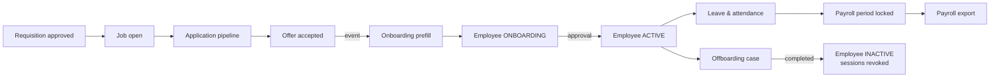

# Architecture

## Decision in one line

A **modular monolith**: one NestJS application and one PostgreSQL database, divided into business modules with
enforced boundaries. Sized for ~200 employees and ≤30 concurrent users; see [ADR-0001](adr/0001-modular-monolith.md).

## System context

```mermaid
flowchart LR
  user([Employee / HR / Admin]) -->|HTTPS, M365 SSO + MFA| fd[Azure Front Door + WAF]
  cand([Candidate]) -->|careers page, offer link| fd
  fd -->|/*| fe[Frontend<br/>Next.js · App Service]
  fd -->|/api/*| be[Backend<br/>NestJS · App Service]
  be --> pg[(PostgreSQL<br/>Flexible Server)]
  be --> blob[(Blob Storage<br/>+ Defender scan)]
  be --> kv[Key Vault]
  be --> entra[Microsoft Entra ID]
  be --> graph[Microsoft Graph<br/>Outlook mail · Teams]
  be --> pdf[Gotenberg<br/>PDF sidecar]
```

One domain (`hrms.gs-it.ae`); Front Door routes `/api/*` to the backend, so the browser sees a single origin
(simple cookies, no CORS exposure). Backend reaches Postgres, Blob and Key Vault with Managed Identity.

## Source layout

```
src/
├── main.ts                 bootstrap (Swagger only outside production)
├── app.module.ts           wires core + business modules and the global guards
├── config/env.ts           validated environment (refuses unsafe production config)
├── core/                   shared infrastructure — never imports src/modules
│   ├── auth/               Entra SSO (MSAL, PKCE), dev login, sessions, CSRF origin guard
│   ├── iam/                permission catalogue, access decorators, deny-by-default guard, data scopes
│   ├── audit/              append-only audit trail
│   ├── crypto/             FieldCipher provider (sensitive column encryption)
│   ├── database/           PrismaService
│   ├── health/             liveness / readiness
│   └── http/               shared HTTP setup (helmet, validation, filters) and OpenAPI
├── shared/                 pure helpers: errors, crypto, CSV safety (no Nest wiring)
├── modules/<module>/       business modules (see map below)
├── cli/                    build-time scripts (OpenAPI export)
└── generated/prisma/       generated client (git-ignored)
```

### Inside a module

```
modules/org/
├── CLAUDE.md               module rules, frontend sources, business rule ids
├── org.module.ts
├── org.public.ts           the ONLY import surface for other modules
├── api/                    controllers + DTOs + response classes (HTTP only)
├── application/            use-case services: orchestrate rules + repositories
├── domain/                 pure rules, state machines, policies (unit tested)
├── infrastructure/         repositories — the only Prisma access
└── events/                 events this module publishes (add when needed)
```

Dependency direction: `api → application → domain`, `application → infrastructure`. Enforced by
`npm run lint:arch` (`.dependency-cruiser.cjs`).

## Module map

| Module                                                                   | Owns                                                                                | Phase | Spec                                                           |
| ------------------------------------------------------------------------ | ----------------------------------------------------------------------------------- | ----- | -------------------------------------------------------------- |
| `org`                                                                    | Locations, companies, departments, designations                                     | 0     | [org.md](modules/org.md)                                       |
| `core/iam` + `core/auth`                                                 | Roles, permissions, sessions, SSO                                                   | 0     | [platform.md](modules/platform.md)                             |
| `core/workflow`                                                          | Approval workflow engine (definitions, instances, decisions)                        | 0     | [platform.md](modules/platform.md)                             |
| `core/notifications`, `core/jobs`, `core/files`, `core/mail`, `core/pdf` | Shared services                                                                     | 0     | [platform.md](modules/platform.md)                             |
| `employees`                                                              | Employee record, profile tables, documents, bank, salary                            | 1     | [employees.md](modules/employees.md)                           |
| `onboarding`                                                             | Onboarding wizard, drafts, approval → Active                                        | 1     | [onboarding-offboarding.md](modules/onboarding-offboarding.md) |
| `offboarding`                                                            | Separation cases, clearance, → Inactive                                             | 1     | [onboarding-offboarding.md](modules/onboarding-offboarding.md) |
| `requests`                                                               | Employee change / letter requests                                                   | 1     | [requests.md](modules/requests.md)                             |
| `compliance`                                                             | Visa, document expiry, reminder ladder                                              | 1     | [compliance.md](modules/compliance.md)                         |
| `hiring`                                                                 | Requisitions → jobs → pipeline → interviews → offers, careers (public)              | 2     | [hiring.md](modules/hiring.md)                                 |
| `leave`, `attendance`                                                    | Leave ledger, policies, holidays, shifts, punches, regularisation, OT, payroll lock | 3     | [leave-attendance.md](modules/leave-attendance.md)             |
| `expense`                                                                | Claims, categories, limits                                                          | 4     | [expense.md](modules/expense.md)                               |
| `performance`, `learning`                                                | Review cycles, learning assignments                                                 | 4     | [performance-learning.md](modules/performance-learning.md)     |
| `reports`, `dashboard`                                                   | Report engine, scheduled reports, role dashboards                                   | 4     | [reports-dashboard.md](modules/reports-dashboard.md)           |
| `payroll`, `assets`, `renewals`                                          | Not designed yet (frontend placeholders)                                            | later | —                                                              |

## Request pipeline

```mermaid
sequenceDiagram
  participant B as Browser
  participant T as ThrottlerGuard
  participant O as OriginGuard (CSRF)
  participant S as SessionGuard
  participant P as PermissionsGuard
  participant V as ValidationPipe
  participant C as Controller → Service → Repository
  B->>T: request + session cookie
  T->>O: within rate limit
  O->>S: GET, or Origin = APP_ORIGIN
  S->>P: req.user attached if session valid (idle 30m, max 12h, employee not Inactive)
  P->>V: @Public / @SignedIn / @RequirePermission satisfied (else 401/403; no rule = 403)
  V->>C: DTO whitelisted, unknown fields rejected
  C-->>B: explicit *Response; errors via AllExceptionsFilter {statusCode, code, message, requestId}
```

## How modules talk

1. **Read another module's data** → inject the service exported from its `*.public.ts`.
2. **React to something that happened elsewhere** → domain events (Nest EventEmitter, in-process), e.g.
   `hiring.offer.accepted` → onboarding prefill; `leave.request.approved` → attendance + notifications.
   Durable/retriable work (emails, reminders) is queued as a pg-boss job by the listener.
3. **Never** import another module's repository, domain file or DTO.

### Key cross-module flows



## Data principles

- **Leave balances are a ledger** (accrual, taken, adjustment, carry-forward, encashment, expiry rows);
  balance = sum. No stored running totals. ([ADR-0005](adr/0005-leave-ledger.md))
- **Country rules are data + strategy**: `Location.template` (`UAE` | `INDIA`) selects a `CountryPolicy`
  (IBAN vs IFSC, EPF/PT, leave types, weekends, sick-certificate rules).
- **Approvals use one workflow engine** shared by requisitions, onboarding, offboarding, requests, leave,
  regularisation, overtime, encashment and expense. ([ADR-0004](adr/0004-workflow-engine.md))
- **Reference by id, never by name.** The frontend stores company/department/designation names; the API
  accepts and returns ids plus display names.
- Times are `timestamptz`; calendar days are `date` interpreted in the location's timezone.
