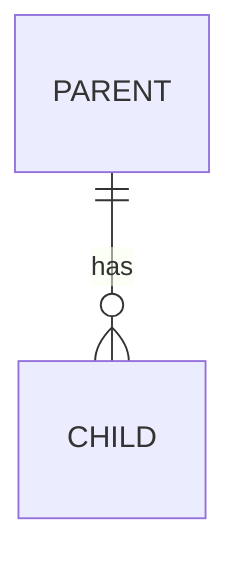
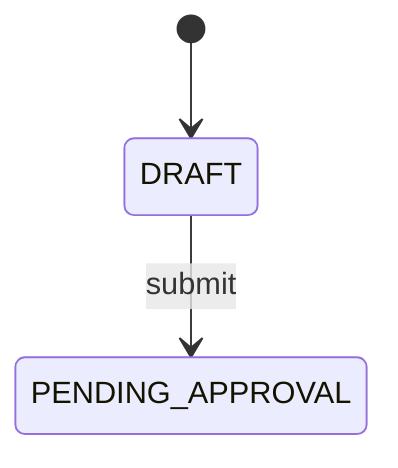

# <Module name>

- Status: Planned | In progress | Done
- Phase: N
- Owner: <developer>
- Source module: `src/modules/<module>/`

## 1. Purpose and scope

What the module does and does not do.

## 2. Frontend sources

Files in `gs-hrms` that define the behaviour (pages, stores, contexts). Note any behaviour the frontend fakes.

## 3. Entities

Key fields, enums, ownership.

## 4. State machines

## 5. Business rules

| Id         | Rule | Enforced in | Test        |
| ---------- | ---- | ----------- | ----------- |
| BR-XXX-001 | …    | `domain/…`  | `….spec.ts` |

## 6. Access

| Action | Permission / rule | Data scope |
| ------ | ----------------- | ---------- |

## 7. Endpoints

| Method                                               | Path | Access | Notes |
| ---------------------------------------------------- | ---- | ------ | ----- |
| (Detail lives in Swagger / `docs/api/openapi.json`.) |

## 8. Events

Published: … · Consumed: …

## 9. Threat model

Sensitive data, who can reach it, abuse cases, mitigations.

## 10. Open questions
