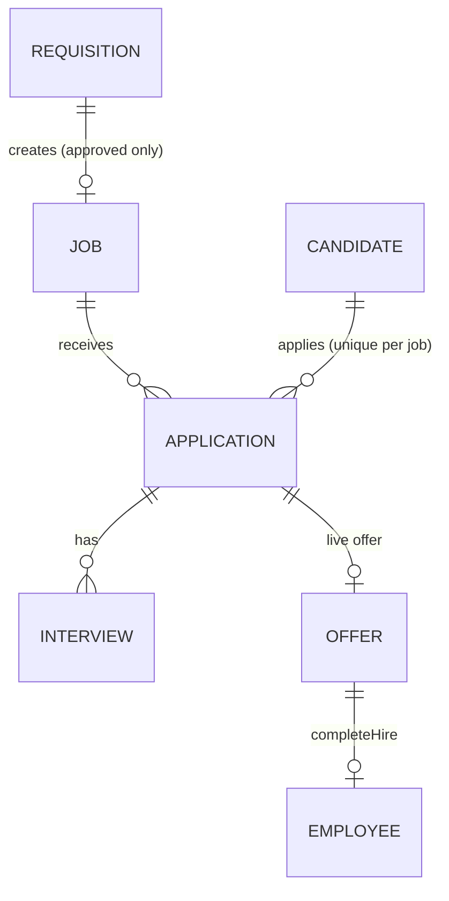
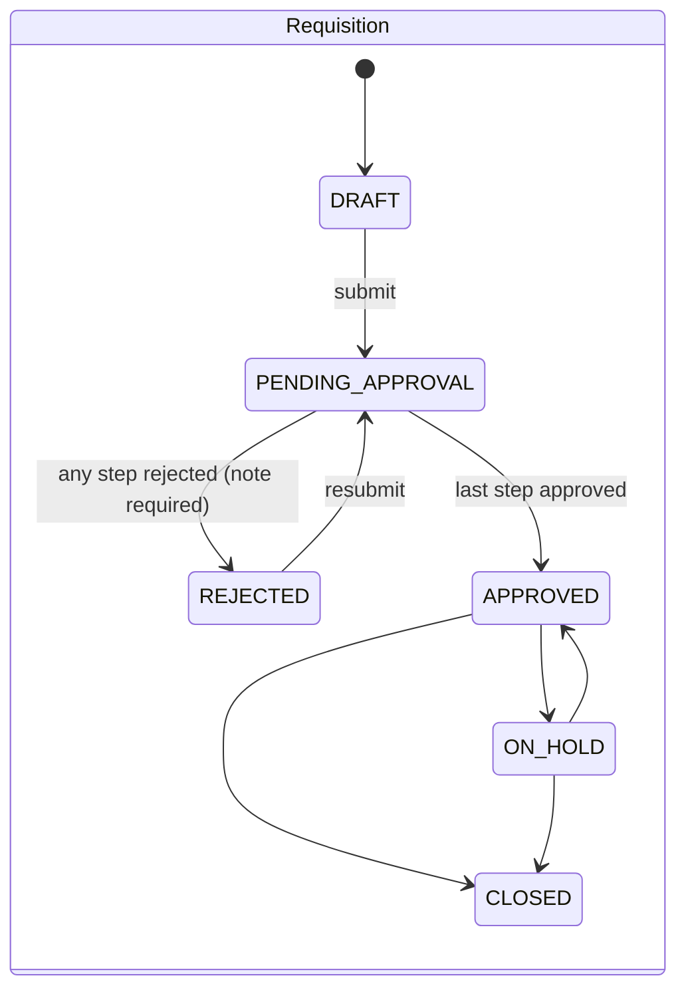

# Hiring

- Status: Planned
- Phase: 2
- Source module: `src/modules/hiring/` (+ public `careers` controller group)

## Frontend sources

`lib/hiringTypes.ts`, `lib/hiringStore.ts` (all mutations), `lib/hiringAccess.ts`, `lib/hiringMail.ts`,
`lib/hiringLetters.ts`, `lib/hiringHandoff.ts`, `app/hiring/**`, `app/careers/**`, `app/offer/respond/[token]`,
`app/my/interviews`, `app/my/referrals`, `components/hiring/**`.

**Frontend gaps:** no interview feedback/scorecards; offer statuses PENDING_APPROVAL/APPROVED/EXPIRED/REVOKED
never set; CVs not stored; email never sent; Outlook/Teams are flags only.

## Entities

- **Requisition** `REQ-0001`: company, department, designation, location, positions, employment type
  (Full-time | Contract | Intern), reason (New role | Replacement, replaces employee), budget min/max + currency,
  target start, hiring manager, justification, approval steps.
- **Job** `JOB-0001`: copied from requisition + description, skills, experience range, qualifications, panel,
  referral-eligible, closing date, recruiter, filled count, history.
- **Candidate**: contact, current employer/title, experience, notice, current/expected salary, visa status,
  source (LinkedIn, Naukri, Bayt, Indeed, Employee Referral, Agency, Careers Page, Direct), referrer, CV (Blob),
  tags, notes, consent, employeeId once hired. Duplicate check: email or last 9 phone digits.
- **Application**: stage, exit (Rejected | Withdrawn | On Hold) + exitFrom + reason, stage history.
- **Interview**: round (Screening call, Technical, HR, Final), date/time/duration, mode (In-person | Teams | Phone),
  panel, link, status (Scheduled | Completed | Cancelled), reschedule count.
- **Offer** `OFF-0001`: salary lines + total + currency, joining date, probation months, expiry, overBudget,
  letter HTML snapshot, token (hashed), sent/viewed/downloaded/responded timestamps, signed name, decline reason.
- **Templates**: email templates (11 built-in, merge fields), stage rules (ask | auto | off), mail settings,
  offer-letter template per location + signatory.

## State machines

- **Job**: DRAFT → OPEN ⇄ ON_HOLD → CLOSED; CLOSED → OPEN if not filled; system sets FILLED when filled = positions
  (and back to OPEN if an acceptance is withdrawn). No candidate moves while CLOSED/FILLED.
- **Pipeline**: APPLIED → SCREENING → TECHNICAL_INTERVIEW → HR_INTERVIEW → OFFER → HIRED (HIRED only via
  accepted offer / onboarding). Scheduling an interview advances the stage forward only. Reject needs one of 11 reasons.
- **Offer**: DRAFT → (letter prepared) → SENT (token) → ACCEPTED | DECLINED; SENT → DRAFT (withdraw link);
  ACCEPTED → DECLINED (withdraw acceptance, reason, before employee exists). Planned: PENDING_APPROVAL/APPROVED
  when over budget, EXPIRED by job.

## Rules (selection)

| Id         | Rule                                                                                                            |
| ---------- | --------------------------------------------------------------------------------------------------------------- |
| BR-HIR-001 | Requisition editable only in DRAFT/REJECTED; submitter who is the hiring manager auto-approves step 1           |
| BR-HIR-002 | Job only from an APPROVED requisition without a job                                                             |
| BR-HIR-003 | Offer only at OFFER stage, no live offer, total > 0; expiry before joining                                      |
| BR-HIR-004 | Send blocked while letter has unfilled merge fields                                                             |
| BR-HIR-005 | Public response requires SENT, not expired, letter downloaded; accept needs typed name, decline needs reason    |
| BR-HIR-006 | Accept ⇒ application HIRED, job.filled +1, maybe FILLED; Decline ⇒ application exits Withdrawn "Offer declined" |
| BR-HIR-007 | Referral credit only for ACTIVE employees on referral-eligible jobs (`?ref=<employeeCode>`)                     |
| BR-HIR-008 | India offer breakup: EPF 12% of Basic capped INR 1,800, Kerala PT by slab, employer PF, gratuity 15/26          |
| BR-HIR-009 | Panel clash detection (same date/time)                                                                          |

## Access (`lib/hiringAccess.ts`)

| Level                                                                                                        | Who                           | Can                                                                   |
| ------------------------------------------------------------------------------------------------------------ | ----------------------------- | --------------------------------------------------------------------- |
| full                                                                                                         | Super Admin, HR, Office Admin | everything incl. offers, operations, reports                          |
| manager                                                                                                      | Team Lead                     | own requisitions; own jobs' candidates, moves, rejections, interviews |
| panel                                                                                                        | any employee                  | candidates they interview (`/my/interviews`)                          |
| referrer                                                                                                     | any employee                  | `/my/referrals`                                                       |
| Salary fields: full level + the job's hiring manager only. Requisition steps: Hiring Manager → that manager; |
| HR → HR/Office Admin; Management → Super Admin.                                                              |

## Public surfaces

`GET /api/public/careers`, `GET /api/public/careers/:code`, `POST /api/public/careers/:code/apply` (Turnstile, CV
scan), `GET/POST /api/public/offers/:token/*` (view, download PDF, accept, decline). See security.md §5.

## Email

Merge fields: candidate.firstName/fullName, job.title/location/department, interview.round/date/time/mode/link,
offer.joiningDate/expiryDate/link, recruiter.name, company.name, portal.link. Auto sends skip messages with
missing fields. Default stage rules: Applied→received (auto), Hired→welcome (auto), others ask.
