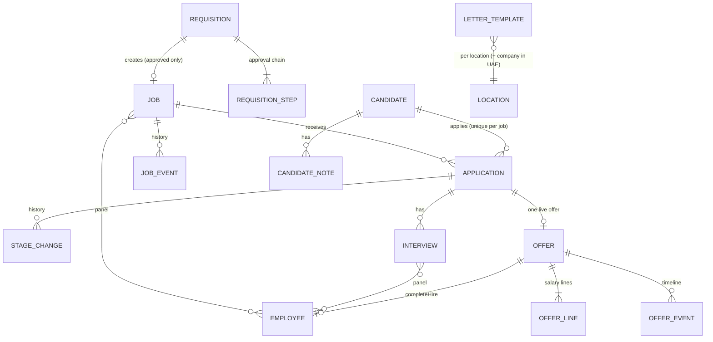
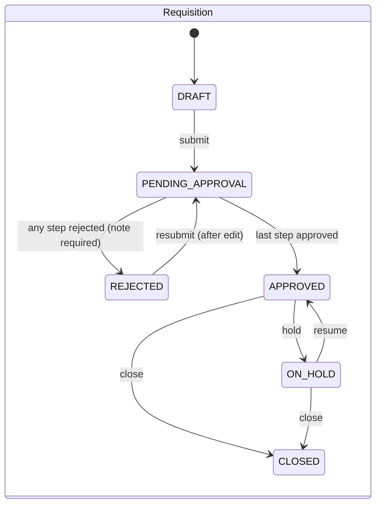
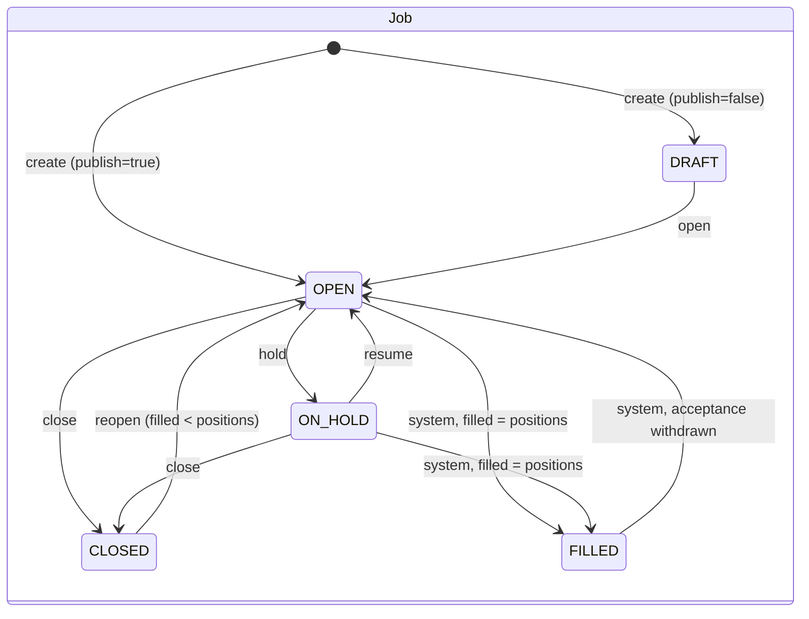
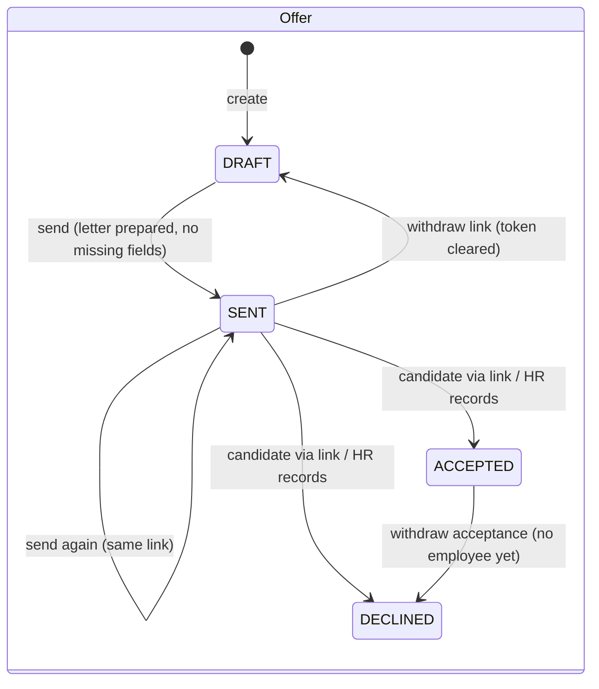

# Hiring

- Status: In progress — steps 0–1 done (requisitions); next: jobs (lead's priority, built step by step — see §11)
- Phase: 2 (brought forward; depends on the Phase 0 items listed in §11)
- Source module: `src/modules/hiring/` (+ public `careers` and `offers` controller groups)
- Frontend reviewed at: `gs-hrms` commit `cad88ae` (2026-10-21)

## 1. Purpose and scope

From "we need a person" to "the person joined": requisition approval, jobs, candidates and their applications,
the pipeline, interviews, offers, offer letters (per location, and per company in the UAE), the public careers page
and offer-response link, hiring emails, and the hand-over to onboarding.

Not in scope: creating the employee record (onboarding module, Phase 1), payroll.

## 2. Frontend sources

`lib/hiringTypes.ts`, `lib/hiringStore.ts` (all mutations), `lib/hiringAccess.ts`, `lib/hiringMail.ts`,
`lib/hiringLetters.ts`, `lib/hiringHandoff.ts`, `lib/workflow.ts` (requisition chain), `lib/guard.ts` (routes),
`lib/access.ts` (permission catalogue), `app/hiring/**`, `app/careers/**`, `app/offer/respond/[token]`,
`app/my/interviews`, `app/my/referrals`, `components/hiring/**` (forms and validation in `HiringForms.tsx`).

### Frontend changes since the first draft of this spec

| Commit (date)      | Change                                                                                                                                               | Backend impact                                                                  |
| ------------------ | ---------------------------------------------------------------------------------------------------------------------------------------------------- | ------------------------------------------------------------------------------- |
| `7a492e3` (19 Oct) | Job **recruiter** (`recruiterId`, change with history + notice); pipeline filters; accepting an offer immediately counts as a hire; careers redesign | `jobs.recruiter_id` (required on create); `PUT /jobs/:id/recruiter`; BR-HIR-006 |
| `2f40d1f` (19 Oct) | **Withdraw an accepted offer** (candidate backed out, before an employee exists); onboarding drafts                                                  | `POST /offers/:id/withdraw-acceptance`; BR-HIR-013                              |
| `cad88ae` (21 Oct) | **Per-company UAE offer letters**: each active UAE company has its own template; India keeps one. Offer records the issuing `companyId`              | Template key = location + company; `offers.company_id`; letterhead per company  |

## 3. Entities

All ids are uuid; the API uses ids, never the names the frontend stores (`department`, `designationTitle`,
`location`). Money is `Decimal(14,2)` + `currency Char(3)`; calendar days `Date`; instants `Timestamptz`.

- **Requisition** `REQ-0001`: title, companyId, departmentId, designationId?, locationId, positions (≥1), employment
  type (`FULL_TIME | CONTRACT | INTERN`), reason (`NEW_ROLE | REPLACEMENT`, then `replacesEmployeeId` required),
  budgetMin/budgetMax + currency, targetStart (date), hiringManagerId, justification, status, createdById.
- **RequisitionStep**: order, label (`HIRING_MANAGER | HR | MANAGEMENT`), status (`WAITING | PENDING | APPROVED |
REJECTED`), decidedById, decidedAt, note. Recreated on every (re)submit.
- **Job** `JOB-0001`: copied from the requisition (title, company, department, location, positions, employment type,
  hiring manager, budget) + designationId, description, skills[], expMin/expMax, qualifications, panelIds[] (≥1),
  referralEligible, closingDate, **recruiterId** (required), filled, status, history (`JobEvent`: at, by, text).
- **Candidate**: name, email (lower-case), phone (+ `phone_key` = last 9 digits, indexed), locationId, currentCity,
  currentCompany, currentTitle, experienceYears, noticeDays, currentSalary?, expectedSalary? + currency, visaStatus,
  source (`LINKEDIN | NAUKRI | BAYT | INDEED | EMPLOYEE_REFERRAL | AGENCY | CAREERS_PAGE | DIRECT`),
  referrerId (required for referral), agency (required for agency), cvFileId (Blob, scanned), links, tags[],
  notes, consentGivenAt, employeeId once hired. Duplicate = same email or same `phone_key` (≥7 digits).
- **Application**: candidateId + jobId (unique), locationId, stage, exit (`REJECTED | WITHDRAWN | ON_HOLD`),
  exitFrom, exitReason, exitNote, appliedAt, history (`StageChange`: at, by, from, to, note).
- **Interview**: applicationId, round (`SCREENING_CALL | TECHNICAL | HR | FINAL`), date, time, durationMin,
  timezone (from location), mode (`IN_PERSON | TEAMS | PHONE`), panelIds[] (≥1), link (https), status
  (`SCHEDULED | COMPLETED | CANCELLED`), notes, rescheduleCount, scheduledById.
- **Offer** `OFF-0001`: applicationId, locationId, **companyId** (from the job), status, currency, lines
  (label, amount; UAE **per month**, India **per year** CTC), total, joiningDate, probationMonths, expiryDate,
  overBudget (`total > job.budgetMax`), letter snapshot (HTML rendered **by the server**) + letterAt + template used,
  tokenHash, sentAt/By, viewedAt, downloadedAt, respondedAt, respondedVia (`LINK | HR`), signedName,
  declineReason, employeeId, events (timeline).
- **LetterTemplate**: key = locationId + companyId? (company only where the location is "per company" — today
  Dubai), html (sanitised), source (`UPLOAD | EDITED`), fileName, updatedBy/At. Built-in template when none.
  **Signatory** per location (name, title).
- **Mail**: EmailTemplate (name, category, subject, body, attachments, built-in flag), StageRule (key → template,
  mode `AUTO | ASK | OFF`), MailSettings, MailMessage log (to, subject, status, candidateId, applicationId).

## 4. State machines

- **Pipeline**: APPLIED → SCREENING → TECHNICAL_INTERVIEW → HR_INTERVIEW → OFFER → HIRED. Any move between the
  first five is allowed (forward or back); HIRED only by an accepted offer. Exit to REJECTED (reason) / WITHDRAWN /
  ON_HOLD from any stage before HIRED; reopen returns to `exitFrom`. Scheduling an interview moves the stage
  **forward only** (Screening call → SCREENING, Technical → TECHNICAL_INTERVIEW, HR → HR_INTERVIEW; Final: none).
- **Offer** statuses `PENDING_APPROVAL`, `APPROVED`, `EXPIRED`, `REVOKED` exist in the frontend type but are never
  set. Not built until the lead decides (§10, Q1–Q2).

## 5. Business rules

| Id         | Rule                                                                                                                                                                                                                                                                                                                                     | Enforced in                                                                                                                    | Test                                                    |
| ---------- | ---------------------------------------------------------------------------------------------------------------------------------------------------------------------------------------------------------------------------------------------------------------------------------------------------------------------------------------- | ------------------------------------------------------------------------------------------------------------------------------ | ------------------------------------------------------- |
| BR-HIR-001 | Requisition editable/(re)submittable only in DRAFT/REJECTED, by its raiser, its hiring manager or HR/Super Admin. Submit builds a fresh chain Hiring Manager → HR → Management; if the submitter is the hiring manager, step 1 is auto-approved and step 2 becomes pending                                                               | `domain/requisition.rules.ts` `assertEditable`, `stepsForSubmit`                                                               | `requisition.rules.spec.ts`, `requisitions.e2e-spec.ts` |
| BR-HIR-002 | Step deciders: Hiring Manager step → that manager; HR step → HR/Office Admin; Management → Super Admin (may decide any step). **Nobody decides the HR or Management step of a requisition they raised** (security.md §2). Reject needs a note; any rejection rejects the requisition; the last approval approves it                      | `domain/requisition.rules.ts` `canDecideStep`, `decideStep`                                                                    | `requisition.rules.spec.ts`, `requisitions.e2e-spec.ts` |
| BR-HIR-003 | Input: positions integer 1–500; 0 < budgetMin ≤ budgetMax (decimal strings, compared in minor units); targetStart not in the past **in the location's timezone**; replacement needs the replaced employee; active company; department of that company; designation of that department; active hiring manager; currency from the location | `domain/requisition.rules.ts` `checkRequisitionInput` + `application/requisitions.service.ts` `checked` + DB CHECK constraints | `requisition.rules.spec.ts`, `requisitions.e2e-spec.ts` |
| BR-HIR-004 | Hold (APPROVED → ON_HOLD), resume (ON_HOLD → APPROVED), close (APPROVED/ON_HOLD → CLOSED) only, by HR/Super Admin (the frontend store allows any status)                                                                                                                                                                                 | `domain/requisition.rules.ts` `statusAfter`                                                                                    | `requisition.rules.spec.ts`, `requisitions.e2e-spec.ts` |
| BR-HIR-005 | Job only from an APPROVED requisition without a job. Requires description, ≥1 skill, expMax ≥ expMin ≥ 0, recruiter, ≥1 panel member, closing date                                                                                                                                                                                       | to do                                                                                                                          | —                                                       |
| BR-HIR-006 | Job status changes only per the state diagram; FILLED is set by the system only; reopen only when filled < positions                                                                                                                                                                                                                     | to do                                                                                                                          | —                                                       |
| BR-HIR-007 | Candidate: name, valid email, phone (≥7 digits), experience ≥ 0, consent required; referral needs referrer; agency needs agency name. Duplicate (email or last-9 phone digits) is refused                                                                                                                                                | to do                                                                                                                          | —                                                       |
| BR-HIR-008 | One application per candidate per job                                                                                                                                                                                                                                                                                                    | to do                                                                                                                          | —                                                       |
| BR-HIR-009 | No stage move while the job is CLOSED or FILLED; no move/exit after HIRED; reject needs one of the 11 reasons                                                                                                                                                                                                                            | to do                                                                                                                          | —                                                       |
| BR-HIR-010 | Interview only for an active application; date not in the past (new); ≥1 panel member; link must be https. Panel clash = same panelist with a SCHEDULED interview that overlaps in time                                                                                                                                                  | to do                                                                                                                          | —                                                       |
| BR-HIR-011 | Offer only at OFFER stage, not exited, no live offer, total > 0, first line (Basic) > 0, joining not in the past, expiry ≤ joining. Currency and company come from the job                                                                                                                                                               | to do                                                                                                                          | —                                                       |
| BR-HIR-012 | Send needs a prepared letter with no unfilled merge fields; letter cannot change after ACCEPTED/DECLINED                                                                                                                                                                                                                                 | to do                                                                                                                          | —                                                       |
| BR-HIR-013 | Accept (link or HR) ⇒ application HIRED, job.filled + 1, job FILLED when filled = positions. Decline ⇒ application exits WITHDRAWN "Offer declined". Withdraw acceptance (reason, no employee) ⇒ offer DECLINED, application WITHDRAWN from OFFER, filled − 1, FILLED → OPEN                                                             | to do                                                                                                                          | —                                                       |
| BR-HIR-014 | Public response: offer SENT, not expired (in the offer location's timezone), letter downloaded; accept needs typed name, decline needs reason; one response only                                                                                                                                                                         | to do                                                                                                                          | —                                                       |
| BR-HIR-015 | Referral credit only for an ACTIVE employee on a referral-eligible job (`?ref=<employeeCode>`)                                                                                                                                                                                                                                           | to do                                                                                                                          | —                                                       |
| BR-HIR-016 | India offer breakup: EPF 12% of Basic capped INR 1,800/month, Kerala PT by slab, employer PF, gratuity 15/26                                                                                                                                                                                                                             | to do                                                                                                                          | —                                                       |
| BR-HIR-017 | Offer letter template: per company where the location is per-company (Dubai), else per location; built-in letter when none. Letterhead/footer and `company.entity` follow the offer's company                                                                                                                                            | to do                                                                                                                          | —                                                       |
| BR-HIR-018 | `completeHire`: only an ACCEPTED offer without an employee; links candidate ↔ employee; counts the position if not yet counted                                                                                                                                                                                                           | to do                                                                                                                          | —                                                       |

## 6. Access

**Decided by the lead (2026-10-22):** Super Admin and HR have full hiring access; a Team Lead can raise a request
for a position (requisition). The backend follows the frontend permission catalogue (`lib/access.ts`), whose
defaults match that decision; Super Admin can change grants later in Roles & Permissions. Code:
`PERMISSIONS.hiring` in `src/core/iam/permission-catalog.ts`.

| Feature id (frontend catalogue)             | Covers                                                     | Default grants                                       |
| ------------------------------------------- | ---------------------------------------------------------- | ---------------------------------------------------- |
| `hiring:requisitions:requisitions`          | requisitions                                               | SA, HR: all · Team Lead, Office Admin: view/add/edit |
| `hiring:requisitions:requisition-approvals` | approval inbox (who decides a step is still BR-HIR-002)    | SA, HR: all · Team Lead, Office Admin: view/add/edit |
| `hiring:recruiting:jobs`                    | jobs                                                       | SA, HR                                               |
| `hiring:recruiting:candidates`              | candidates, applications, pipeline                         | SA, HR                                               |
| `hiring:recruiting:interviews`              | interviews                                                 | SA, HR                                               |
| `hiring:recruiting:offers`                  | offers, letters                                            | SA, HR                                               |
| `hiring:reports:hiring-reports`             | dashboard numbers, reports (view only)                     | SA, HR                                               |
| _(none yet)_                                | operations: email templates, stage rules, letter templates | decide before step 6 (Q3)                            |

Data scope (in the repository query, rule 8):

| Who                     | Sees                                                                                            |
| ----------------------- | ----------------------------------------------------------------------------------------------- |
| Super Admin, HR         | everything                                                                                      |
| Team Lead, Office Admin | requisitions they manage or raised, those waiting on a step they decide, and those they decided |
| Any employee (panel)    | interviews they are on, and the candidate profile behind them (read-only)                       |
| Any employee (referrer) | their referrals' name, job and stage only                                                       |
| Salary fields           | current/expected/offered pay: Super Admin, HR + that job's hiring manager; omitted for others   |

## 7. Endpoints

Built step by step (§11). `Access`: P = permission, S = signed in + scope rule, Pub = public.

| Step | Method         | Path                                                                 | Access                                    | Notes                                                                              |
| ---- | -------------- | -------------------------------------------------------------------- | ----------------------------------------- | ---------------------------------------------------------------------------------- |
| 1 ✅ | GET            | `/api/hiring/requisitions`                                           | P requisitions (scoped)                   | paged; `status`, `locationId`, `waitingOnMe` (approval inbox)                      |
| 1 ✅ | GET            | `/api/hiring/requisitions/:id`                                       | P requisitions (scoped)                   | with steps and `viewer` (canEdit/canDecide/canManage) — job link arrives in step 2 |
| 1 ✅ | POST           | `/api/hiring/requisitions`                                           | P requisitions#add                        | `submit` flag                                                                      |
| 1 ✅ | PATCH          | `/api/hiring/requisitions/:id`                                       | P requisitions#edit (scoped)              | DRAFT/REJECTED only                                                                |
| 1 ✅ | POST           | `/api/hiring/requisitions/:id/submit`                                | P requisitions#edit (scoped)              | BR-HIR-001                                                                         |
| 1 ✅ | POST           | `/api/hiring/requisitions/:id/decision`                              | P requisition-approvals#edit + BR-HIR-002 | `{ decision, note }`                                                               |
| 1 ✅ | POST           | `/api/hiring/requisitions/:id/hold` · `/resume` · `/close`           | P requisitions#edit + HR/SA               | BR-HIR-004                                                                         |
| 2    | GET            | `/api/hiring/jobs` · `/:id`                                          | P jobs (scoped)                           | with history                                                                       |
| 2    | POST           | `/api/hiring/requisitions/:id/job`                                   | P jobs#add                                | BR-HIR-005                                                                         |
| 2    | PUT            | `/api/hiring/jobs/:id`                                               | P jobs#edit                               | description, skills, panel, closing date                                           |
| 2    | POST           | `/api/hiring/jobs/:id/status`                                        | P jobs#edit                               | `{ action: open/hold/resume/close/reopen }`                                        |
| 2    | PUT            | `/api/hiring/jobs/:id/recruiter`                                     | P jobs#edit                               | notifies the new recruiter                                                         |
| 2    | GET            | `/api/public/careers` · `/:code`                                     | Pub                                       | OPEN jobs only, public fields only                                                 |
| 3    | GET            | `/api/hiring/candidates` · `/:id`                                    | P candidates (scoped) / panel             | salary per §6                                                                      |
| 3    | POST           | `/api/hiring/candidates`                                             | P candidates#add                          | optional `jobId`; duplicate check                                                  |
| 3    | GET            | `/api/hiring/candidates/duplicates?email=&phone=`                    | P candidates#add                          | form warning                                                                       |
| 3    | POST           | `/api/hiring/candidates/:id/applications`                            | P candidates#add                          | BR-HIR-008                                                                         |
| 3    | PUT            | `/api/hiring/candidates/:id/tags`                                    | P candidates#edit                         |                                                                                    |
| 3    | POST           | `/api/hiring/candidates/:id/notes`                                   | P candidates#edit                         |                                                                                    |
| 3    | POST           | `/api/hiring/applications/:id/move` · `/exit` · `/reopen`            | P candidates#edit (scoped)                | BR-HIR-009                                                                         |
| 4    | GET            | `/api/hiring/interviews`                                             | P interviews (scoped)                     |                                                                                    |
| 4    | GET            | `/api/hiring/interviews/clashes`                                     | P interviews#add                          | BR-HIR-010                                                                         |
| 4    | POST           | `/api/hiring/interviews`                                             | P interviews#add (scoped)                 | may advance stage                                                                  |
| 4    | PUT            | `/api/hiring/interviews/:id`                                         | P interviews#edit (scoped)                | reschedule                                                                         |
| 4    | POST           | `/api/hiring/interviews/:id/complete` · `/cancel`                    | P interviews#edit (scoped)                |                                                                                    |
| 4    | GET            | `/api/me/interviews`                                                 | SignedIn (panelist = me)                  | `/my/interviews`                                                                   |
| 4    | GET            | `/api/me/referrals`                                                  | SignedIn (referrer = me)                  | `/my/referrals`                                                                    |
| 5    | GET            | `/api/hiring/offers` · `/:id`                                        | P offers                                  |                                                                                    |
| 5    | POST           | `/api/hiring/applications/:id/offer`                                 | P offers#add                              | BR-HIR-011                                                                         |
| 5    | POST           | `/api/hiring/offers/:id/response`                                    | P offers#edit                             | HR records accept/decline (`via: HR`)                                              |
| 5    | POST           | `/api/hiring/offers/:id/withdraw-acceptance`                         | P offers#edit                             | BR-HIR-013                                                                         |
| 6    | GET/PUT/DELETE | `/api/hiring/letter-templates/:location[/:companyId]`                | P offers#edit (ops)                       | upload .docx/.html, sanitise                                                       |
| 6    | PUT            | `/api/hiring/letter-signatories/:location`                           | P offers#edit (ops)                       |                                                                                    |
| 6    | POST           | `/api/hiring/offers/:id/letter`                                      | P offers#edit                             | server renders from template                                                       |
| 6    | POST           | `/api/hiring/offers/:id/send` · `/withdraw-link`                     | P offers#edit                             | token issued / cleared                                                             |
| 6    | GET            | `/api/public/offers/:token` · `/pdf`                                 | Pub (token)                               | records view / download                                                            |
| 6    | POST           | `/api/public/offers/:token/accept` · `/decline`                      | Pub (token)                               | BR-HIR-014                                                                         |
| 7    | POST           | `/api/public/careers/:code/apply`                                    | Pub (Turnstile, rate limit)               | CV upload + scan, referral                                                         |
| 8    | CRUD           | `/api/hiring/mail/templates`, `/rules`, `/settings`, `GET /mail/log` | ops                                       | needs `core/mail`                                                                  |
| 9    | GET            | `/api/hiring/offers/:id/onboarding-prefill`                          | P offers                                  | needs onboarding module                                                            |
| 9    | GET            | `/api/hiring/reports/*`, `/dashboard`                                | P hiring-reports                          |                                                                                    |

## 8. Events

Published: `RequisitionSubmitted`, `RequisitionStepPending`, `RequisitionDecided`, `JobRecruiterChanged`,
`CandidateApplied` (careers), `InterviewScheduled/Rescheduled/Cancelled`, `OfferSent`, `OfferViewed`,
`OfferResponded`, `OfferAcceptanceWithdrawn`, `ApplicationStageChanged` (drives stage emails).
Consumed: `EmployeeCreatedFromOffer` (onboarding → `completeHire`).
Until `core/notifications` exists, events are published with no listener (no in-app notices yet).

## 9. Threat model

- **Data**: candidate PII (name, email, phone, CV), salary (current/expected/offered), referral relationships.
- **IDOR**: every `:id` route resolves through a scoped query (Team Lead → own jobs; panelist → own interviews).
- **Salary leakage**: salary fields are omitted (not nulled-then-filled client side) for callers outside §6.
- **Public offer link**: 256-bit token, stored hashed, cleared on withdraw, dead after response/expiry, rate
  limited; views/downloads audited. Never accept letter HTML from the client — the server renders it.
- **Careers apply**: Turnstile, rate limit, CV type/size check + malware scan before anyone can open it, no
  "already applied" / "already on file" disclosure (frontend message names the existing candidate — must not reach
  the public). Duplicate merge must not let an applicant overwrite an existing candidate's details.
- **Templates**: uploaded/edited letter and email HTML is sanitised; merge values are HTML-escaped.
- **Audit**: every mutation, in the same transaction; salary in audit `before/after` follows the answer to Q8 (if encrypted, audit records the change, not the value).

## 10. Open questions and frontend gaps (for the lead)

**Behaviour the frontend leaves open — backend needs a decision**

1. **Offer approval**: `overBudget` is only a warning. Should an over-budget offer need approval (who?) before
   sending? Statuses PENDING_APPROVAL/APPROVED exist but are never used.
2. **Offer expiry**: an expired offer only blocks the public response. Should the system move SENT → EXPIRED
   (nightly job), and can HR extend the expiry?
3. **Access model** — _decided 2026-10-22_: Super Admin + HR full, Team Lead raises requisitions; backend follows the
   permission catalogue. **Frontend follow-up:** `lib/hiringAccess.ts` still gives Office Admin full access and Team
   Lead the candidate pipeline of their own jobs — the frontend should switch to `can()` with the catalogue ids.
   **Still open:** which permission covers the operations screens (email/letter templates) — needed by step 6.
4. **Requisition approval chain** — _decided 2026-10-22_: fixed Hiring Manager → HR → Management, as in the frontend
   (its Workflow Settings page only displays chains). Steps are stored per requisition so a configurable chain
   (ADR-0004 workflow engine) can replace it later without a data redesign.
5. **Hiring manager without hiring access**: the frontend lets any active employee be the hiring manager, but only
   people with Requisition approvals → Edit can decide a step. An Employee-role hiring manager can never approve
   their step (only Super Admin can). Limit the picker to Team Leads and above, or let any hiring manager decide?
6. **Raising your own requisition**: the backend now blocks deciding the HR or Management step of a requisition you
   raised (security.md "nobody decides their own request"); the frontend allows it. Consequences: HR-raised
   requisitions need Office Admin, another HR or Super Admin for the HR step; one raised by the only Super Admin
   can never pass the Management step. Confirm, or name who decides in that case. (The Hiring Manager step is still
   auto-approved when the hiring manager submits — that is the frontend's rule.)
7. **Interview feedback / scorecards**: none (free notes only). Needed for v1?
8. **HR "Record accepted/declined"**: allowed today without the letter being downloaded or the offer being in date.
   Keep? Should it require an attachment/note as evidence?
9. **Exiting an application with a live (SENT) offer**: the offer stays SENT and the candidate can still accept a
   rejected/withdrawn application. Proposal: exiting withdraws the link (offer → DRAFT) or is refused.
10. **Salary at rest**: candidate and offer salary are not in rule 10's encrypted list. Encrypt them, or restrict
    by access only?
11. **Per-company letters**: "per company" is hard-coded to Dubai. Make it a location setting?
12. **Retention**: how long are rejected candidates and CVs kept (consent period)?

**Frontend store guards missing (the backend will enforce the UI's rules, not the store's)**

- `setRequisitionStatus` and `setJobStatus` accept any status (e.g. Draft → Approved bypasses approval).
- `setOfferStatus` lets HR set Accepted/Declined on a DRAFT offer (UI only shows it for SENT).
- `rescheduleInterview`/`setInterviewStatus` work on cancelled/completed interviews.
- Panel clash only compares identical start times, not overlapping durations.
- `moveStage` error text says Hired is set by onboarding; since `7a492e3` it is set by acceptance.
- Offer token uses `Math.random`; letter HTML and PDF are produced in the browser.

**Not built in the frontend**: CV storage (file name only), real email, Outlook/Teams (switches only).

## 11. Build plan (step by step)

Each step ships per CLAUDE.md rules 15–19 (Swagger, e2e + 403/404 tests, Bruno, OpenAPI, docs).

| Step | Scope                                                            | Needs first (backend gaps)                                                                                                          |
| ---- | ---------------------------------------------------------------- | ----------------------------------------------------------------------------------------------------------------------------------- |
| 0    | ✅ Module scaffold, hiring permission ids, default grants        | done                                                                                                                                |
| 1    | ✅ Requisitions + approval steps                                 | done. Reference checks read org/employee tables directly until their APIs exist; no in-app notices yet (needs `core/notifications`) |
| 2    | Jobs, recruiter, history, public careers list/detail             | —                                                                                                                                   |
| 3    | Candidates, applications, pipeline                               | Q7, Q8                                                                                                                              |
| 4    | Interviews, `/me/interviews`, `/me/referrals`                    | —                                                                                                                                   |
| 5    | Offers (create, HR response, withdraw acceptance)                | Q1, Q6                                                                                                                              |
| 6    | Letter templates, server-rendered letter, PDF, public offer link | `core/pdf` (Gotenberg), HTML sanitiser, .docx → HTML converter, Q2                                                                  |
| 7    | Public apply with CV                                             | `core/files` (Blob + scan), Turnstile, rate limiting                                                                                |
| 8    | Email templates, stage rules, mail log                           | `core/mail`, `core/jobs` (pg-boss)                                                                                                  |
| 9    | Onboarding prefill + `completeHire`, reports, dashboard          | onboarding/employees modules (Phase 1), `core/notifications`                                                                        |
