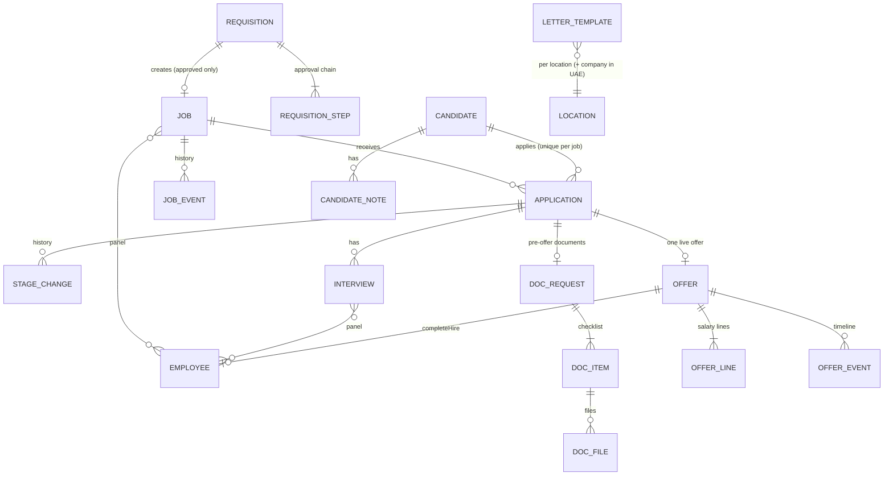
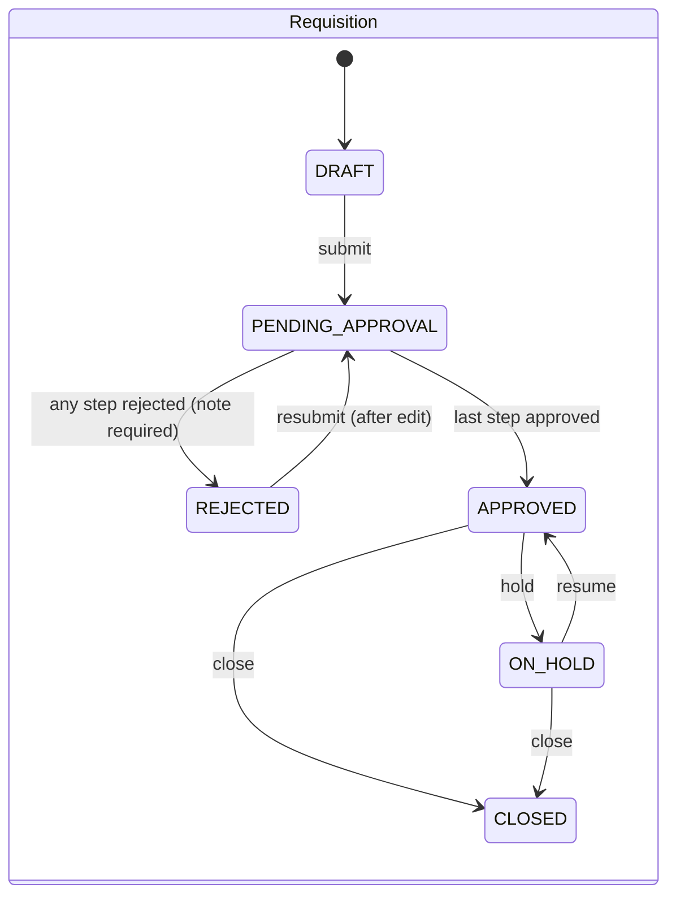
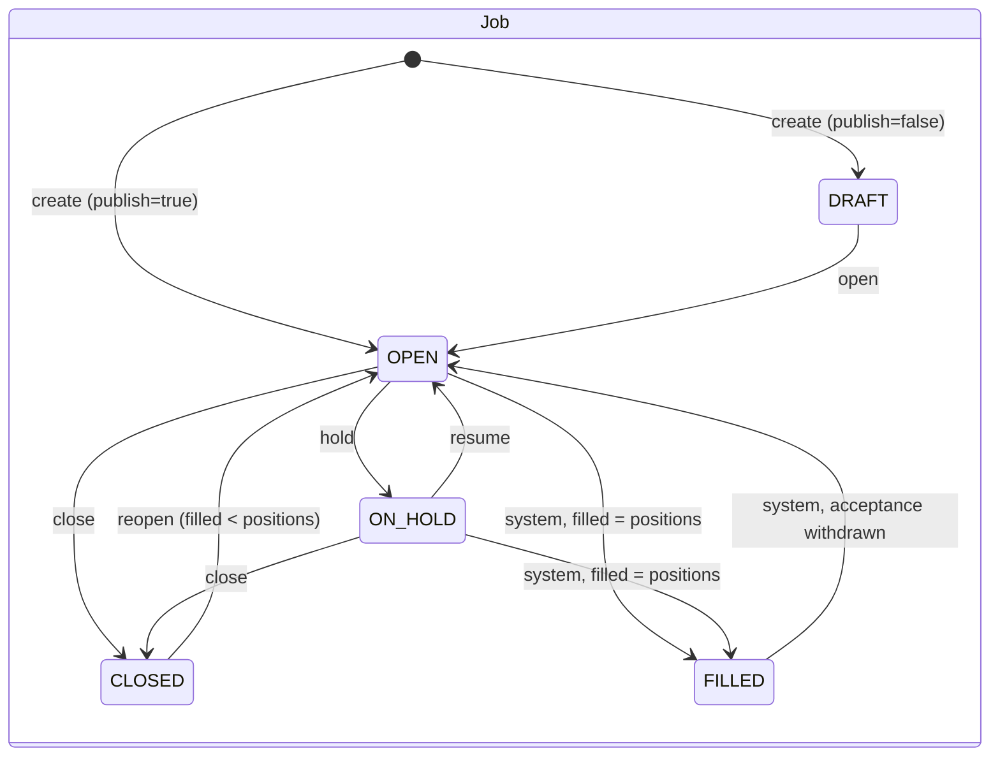
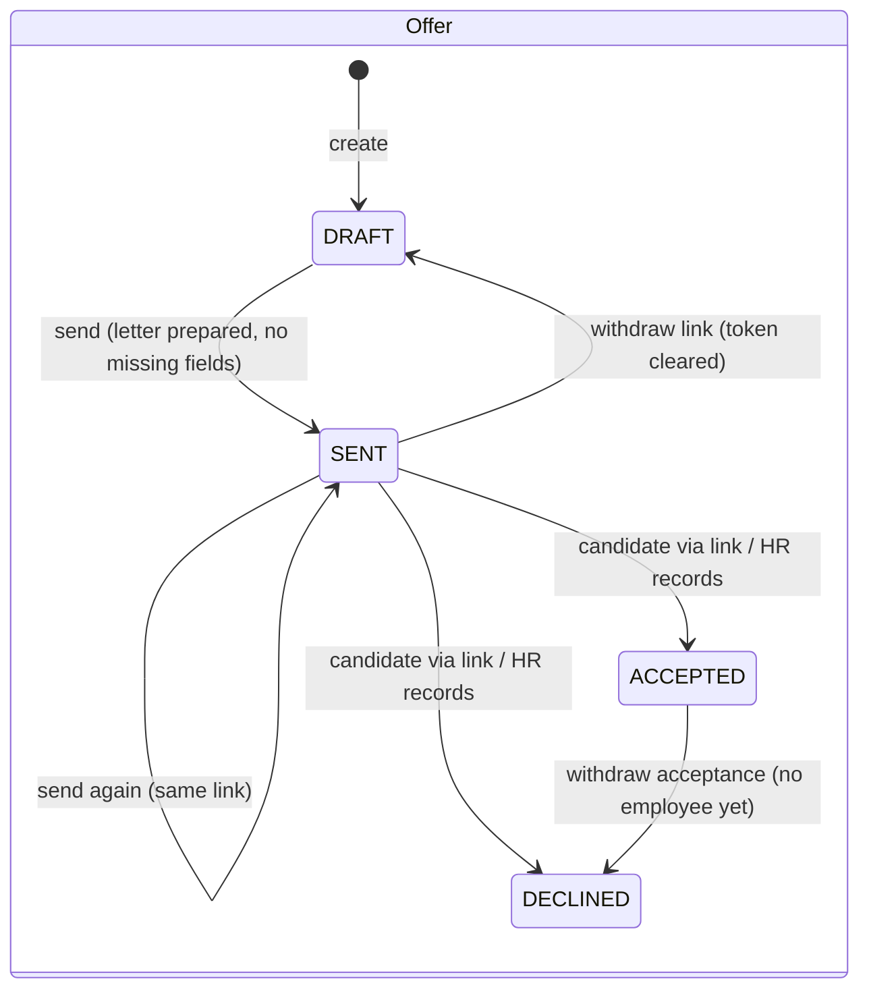
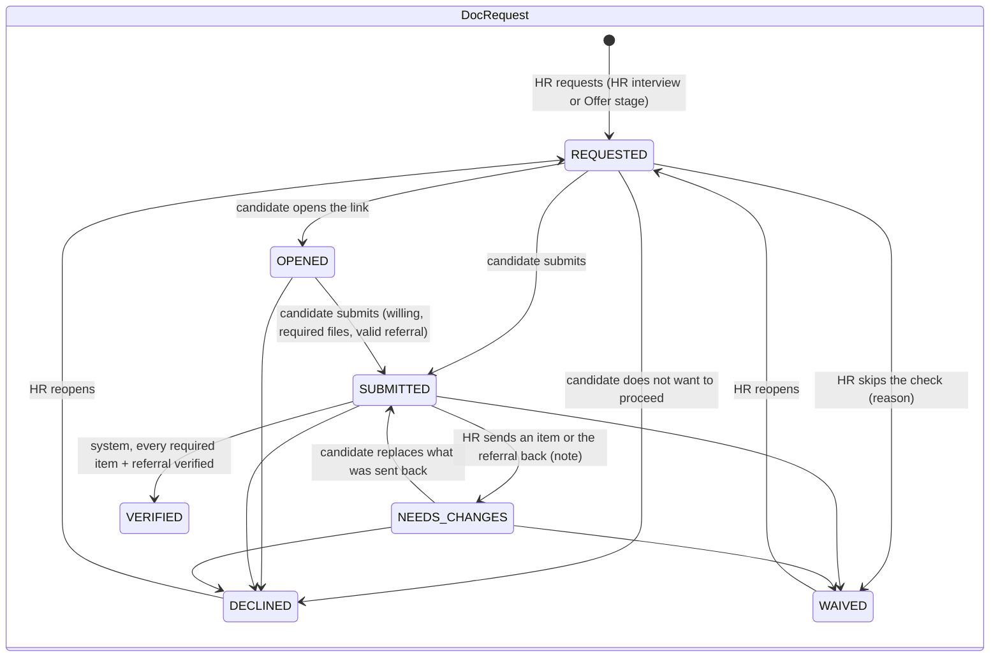

# Hiring

- Status: In progress — steps 0–3 done (requisitions, jobs, candidates and pipeline); steps 1–3 need the follow-ups
  from the 28–29 Oct frontend changes (§11, "Rework"); next: interviews (lead's priority, built step by step — see §11)
- Phase: 2 (brought forward; depends on the Phase 0 items listed in §11)
- Source module: `src/modules/hiring/` (+ public `careers` and `offers` controller groups)
- Frontend reviewed at: `gs-hrms` commit `292aca6` (2026-10-29; last hiring change `8609a8e`)

## 1. Purpose and scope

From "we need a person" to "the person joined": requisition approval, jobs, candidates and their applications,
the pipeline, interviews, pre-offer documents and background-verification referral, offers, offer letters (per location, and per company in the UAE), the public careers page
and offer-response link, hiring emails, and the hand-over to onboarding.

Not in scope: creating the employee record (onboarding module, Phase 1), payroll.

**Nothing is public (lead decision 2026-10-22).** No careers pages, public apply or other endpoint reachable without
sign-in. Jobs are posted manually on the company website, LinkedIn, Indeed etc. (the frontend's "Copy job text"),
candidates apply through those channels, and HR adds them with the source recorded. **Later phase:** push jobs from
the HRMS to the company website, job boards and social media, and pull applications back into the pipeline
(LinkedIn/Indeed need partner/ATS approval; Naukri/Bayt need an employer API plan; the website can use an HRMS API).

## 2. Frontend sources

`lib/hiringTypes.ts`, `lib/hiringStore.ts` (all mutations), `lib/hiringAccess.ts`, `lib/hiringMail.ts`,
`lib/hiringLetters.ts`, `lib/hiringHandoff.ts`, `lib/hiringDocs.ts` (pre-offer documents), `lib/workflow.ts`
(requisition chain), `lib/guard.ts` (routes), `lib/access.ts` (permission catalogue), `context/OrgContext.tsx` (new
designations join the department), `app/hiring/**`, `app/careers/**`, `app/offer/respond/[token]`,
`app/offer/documents/[token]`, `app/my/interviews`, `app/my/referrals`, `components/hiring/**` (forms and validation
in `HiringForms.tsx`, pre-offer documents in `DocCollection.tsx`).

### Frontend changes since the first draft of this spec

| Commit (date)                | Change                                                                                                                                                                                                                                                                                                                                                                                                                                                                                                                | Backend impact                                                                                                                 |
| ---------------------------- | --------------------------------------------------------------------------------------------------------------------------------------------------------------------------------------------------------------------------------------------------------------------------------------------------------------------------------------------------------------------------------------------------------------------------------------------------------------------------------------------------------------------- | ------------------------------------------------------------------------------------------------------------------------------ |
| `7a492e3` (19 Oct)           | Job **recruiter** (`recruiterId`, change with history + notice); pipeline filters; accepting an offer immediately counts as a hire; careers redesign                                                                                                                                                                                                                                                                                                                                                                  | `jobs.recruiter_id` (required on create); `PUT /jobs/:id/recruiter`; BR-HIR-006                                                |
| `2f40d1f` (19 Oct)           | **Withdraw an accepted offer** (candidate backed out, before an employee exists); onboarding drafts                                                                                                                                                                                                                                                                                                                                                                                                                   | `POST /offers/:id/withdraw-acceptance`; BR-HIR-013                                                                             |
| `cad88ae` (21 Oct)           | **Per-company UAE offer letters**: each active UAE company has its own template; India keeps one. Offer records the issuing `companyId`                                                                                                                                                                                                                                                                                                                                                                               | Template key = location + company; `offers.company_id`; letterhead per company                                                 |
| `0adf15d`–`d0311af` (23 Oct) | **Offer e-signature**: accepting needs a drawn signature (PNG) and the typed name must match the candidate's name (`nameProblem`: letters only, first + last, case/accents ignored); signed name stored as the candidate's name. Company picked per letter (`saveOfferLetter` `companyId`). Hand-over carries the joiner's submitted joining form. Date picker, careers redesign, role editor (catalogue unchanged)                                                                                                   | Steps 5–6: `offers.signature`/`signed_at`, name check on accept; step 9: joining form in prefill. Step 3: none                 |
| `dd34b97` (28 Oct)           | **Pre-offer documents**: before an offer can be created, HR asks the candidate (private link, no sign-in) to confirm they want to proceed, upload a per-country checklist and give a background-verification (BGV) referral; HR verifies or sends back each item; the offer button stays disabled until the request is Verified or HR **waives** it with a reason. Three new "Documents" email templates. Verified papers and the referral are carried into the joining form / hand-over                              | New step 5a (§11): `doc_requests`, `doc_items`; BR-HIR-011 changed; BR-HIR-023…026; Q18–Q20                                    |
| `62f2297` (29 Oct)           | **Requisition form**: designation chosen right after department (required when the department has any) and fills the job title; changing company/department/location clears it. **A Team Lead requests only for their own department or departments they head**; company and location follow the department, and they are the hiring manager                                                                                                                                                                          | BR-HIR-003 changed; BR-HIR-019 (rework of step 1)                                                                              |
| `8609a8e` (29 Oct)           | **Talent Acquisition team**: system roles _Talent Acquisition Manager_ (full hiring) and _Recruiter_ (Recruiting only; sees only their own jobs). A new job is **handed to the TA Manager**, who chooses the recruiter (from the TA team); recruiter may be empty until then. Recruiter sees salary on their jobs. **New-designation request** on a requisition: free-text title, added to the department only once the requisition is fully approved. Team Lead picks the country when their department runs in both | BR-HIR-005 changed; BR-HIR-020…022; `jobs.ta_manager_id`, nullable `recruiter_id`; two system roles (Q21, rework of steps 1–3) |

## 3. Entities

All ids are uuid; the API uses ids, never the names the frontend stores (`department`, `designationTitle`,
`location`). Money is `Decimal(14,2)` + `currency Char(3)`; calendar days `Date`; instants `Timestamptz`.

- **Requisition** `REQ-0001`: title, companyId, departmentId, designationId? **or** proposedDesignation (new-designation
  request, 2–80 chars, `8609a8e` — becomes a Designation of the department when the requisition is APPROVED,
  BR-HIR-020), locationId, positions (≥1), employment
  type (`FULL_TIME | CONTRACT | INTERN`), reason (`NEW_ROLE | REPLACEMENT`, then `replacesEmployeeId` required),
  budgetMin/budgetMax + currency, targetStart (date), hiringManagerId, justification, status, createdById.
- **RequisitionStep**: order, label (`HIRING_MANAGER | HR | MANAGEMENT`), status (`WAITING | PENDING | APPROVED |
REJECTED`), decidedById, decidedAt, note. Recreated on every (re)submit.
- **Job** `JOB-0001` (one per requisition): title, company, department, location, positions, employment type, hiring
  manager and budget are **read from the requisition** (it cannot change once approved; the frontend copies them) +
  designationId (defaults to the requisition's, must be in its department), description, skills[] (1–30),
  expMin/expMax (whole years), qualifications, panel (`JobPanelMember`, ≥1 active employee), referralEligible,
  closingDate, **taManagerId?** (the Talent Acquisition Manager the job was handed to, `8609a8e`), **recruiterId?**
  (active employee; empty until the TA Manager chooses — BR-HIR-021), filled, status, history (`JobEvent`: at, actor, text — append-only: a trigger refuses UPDATE/DELETE and a job with history cannot be deleted).
- **Candidate**: name, email (lower-case, unique), phone (+ `phone_key` = last 9 digits, indexed), locationId (the
  job's when added to a job), currentCity, currentCompany, currentTitle, experienceYears, noticeDays,
  currentSalary? / expectedSalary? (Decimal, currency from the location — salary rules in §6), visaStatus, source
  (`LINKEDIN | NAUKRI | BAYT | INDEED | EMPLOYEE_REFERRAL | AGENCY | CAREERS_PAGE | DIRECT`; `CAREERS_PAGE` = the
  company website), referrerId (active employee, required for referral), agency (required for agency), **cvName**
  (file name only until file storage exists — decided 2026-10-23), links, tags[] (≤20 × ≤40 chars),
  consentGivenAt, createdById, employeeId once hired. **CandidateNote**: text, by, at — append-only.
  Duplicate = same email or same `phone_key` (≥7 digits).
- **Application**: candidateId + jobId (unique), location read through the job (not copied), stage, exit (`REJECTED | WITHDRAWN |
ON_HOLD`), exitFrom, exitReason, exitNote, appliedAt, updatedAt (= last stage change, for "days in stage"), history (**StageChange**: at, by, from, to, note —
  append-only by trigger, like `JobEvent`).
- **Interview**: applicationId, round (`SCREENING_CALL | TECHNICAL | HR | FINAL`), date, time, durationMin,
  timezone (from location), mode (`IN_PERSON | TEAMS | PHONE`), panelIds[] (≥1), link (https), status
  (`SCHEDULED | COMPLETED | CANCELLED`), notes, rescheduleCount, scheduledById.
- **DocRequest** (pre-offer documents, one per application, `dd34b97`): applicationId, status (§4), tokenHash, dueDate
  (shown, not enforced), sentAt/By, openedAt, submittedAt, verifiedAt/By, willing (`YES | NO`) + willingAt,
  declineReason, waived (reason, by, at), verifiedMailAt, fixMailAt; **BGV referral** (name, designation, phone 7–15
  digits) + bgvStatus + bgvNote. **DocItem**: key, label, required, status (`PENDING | RECEIVED | VERIFIED | REJECTED`),
  note (why sent back), verifiedBy/At. **DocFile**: blob ref, name, size (≤10 MB, PDF/JPG/PNG), uploadedAt. The
  checklist is fixed per country (BR-HIR-023). Files hold passport, Aadhaar, PAN, payslips — sensitive (§9).
- **Offer** `OFF-0001`: applicationId, locationId, **companyId** (from the job), status, currency, lines
  (label, amount; UAE **per month**, India **per year** CTC), total, joiningDate, probationMonths, expiryDate,
  overBudget (`total > job.budgetMax`), letter snapshot (HTML rendered **by the server**) + letterAt + template used,
  tokenHash, sentAt/By, viewedAt, downloadedAt, respondedAt, respondedVia (`LINK | HR`), signedName,
  declineReason, employeeId, events (timeline).
- **LetterTemplate**: key = locationId + companyId? (company only where the location is "per company" — today
  Dubai), html (sanitised), source (`UPLOAD | EDITED`), fileName, updatedBy/At. Built-in template when none.
  **Signatory** per location (name, title).
- **Mail**: EmailTemplate (name, category, subject, body, attachments, built-in flag), StageRule (key → template,
  mode `AUTO | ASK | OFF`), MailSettings, MailMessage log (to, subject, status, candidateId, applicationId).

## 4. State machines

- **Job recruiter** (`8609a8e`): when a TA Manager exists and someone else creates the job, the job is created with
  `taManagerId` set and **no recruiter** ("Not chosen yet (name)"), a History line "Handed to … to choose the
  recruiter", and a notice to the TA Manager. The TA Manager (or Super Admin) then _chooses_ the recruiter; later
  changes are "Recruiter changed from … to …". With no TA Manager, the creator picks the recruiter as before.

- **Pipeline**: APPLIED → SCREENING → TECHNICAL_INTERVIEW → HR_INTERVIEW → OFFER → HIRED. Any move between the
  first five is allowed (forward or back); HIRED only by an accepted offer. Exit to REJECTED (reason) / WITHDRAWN /
  ON_HOLD from any stage before HIRED; reopen returns to `exitFrom`. Scheduling an interview moves the stage
  **forward only** (Screening call → SCREENING, Technical → TECHNICAL_INTERVIEW, HR → HR_INTERVIEW; Final: none).
- **Offer** statuses `PENDING_APPROVAL`, `APPROVED`, `EXPIRED`, `REVOKED` exist in the frontend type but are never
  set. Not built until the lead decides (§10, Q1–Q2).

## 5. Business rules

| Id         | Rule                                                                                                                                                                                                                                                                                                                                                                                                                                                                                                                                                                                                                                                                                                                                                                                                                          | Enforced in                                                                                                                    | Test                                                    |
| ---------- | ----------------------------------------------------------------------------------------------------------------------------------------------------------------------------------------------------------------------------------------------------------------------------------------------------------------------------------------------------------------------------------------------------------------------------------------------------------------------------------------------------------------------------------------------------------------------------------------------------------------------------------------------------------------------------------------------------------------------------------------------------------------------------------------------------------------------------- | ------------------------------------------------------------------------------------------------------------------------------ | ------------------------------------------------------- |
| BR-HIR-001 | Requisition editable/(re)submittable only in DRAFT/REJECTED, by its raiser, its hiring manager or HR/Super Admin. Submit builds a fresh chain Hiring Manager → HR → Management; if the submitter is the hiring manager, step 1 is auto-approved and step 2 becomes pending                                                                                                                                                                                                                                                                                                                                                                                                                                                                                                                                                    | `domain/requisition.rules.ts` `assertEditable`, `stepsForSubmit`                                                               | `requisition.rules.spec.ts`, `requisitions.e2e-spec.ts` |
| BR-HIR-002 | Step deciders: Hiring Manager step → that manager; HR step → HR/Office Admin; Management → Super Admin (may decide any step). **Nobody decides any step of a requisition they raised** (security.md §2) — except the hiring manager their own step, and a Super Admin the Management step (top of the chain, after the others approved). Reject needs a note; any rejection rejects the requisition; the last approval approves it                                                                                                                                                                                                                                                                                                                                                                                            | `domain/requisition.rules.ts` `canDecideStep`, `decideStep`                                                                    | `requisition.rules.spec.ts`, `requisitions.e2e-spec.ts` |
| BR-HIR-003 | Input: positions integer 1–500; 0 < budgetMin ≤ budgetMax (decimal strings, compared in minor units); targetStart not in the past **in the location's timezone**; replacement needs the replaced employee; active company; department of that company; designation of that department; active hiring manager who holds Requisition approvals → Edit (Q11); currency from the location. **Changed `62f2297`/`8609a8e`:** a designation is required when the department has any (unless a new one is proposed, BR-HIR-020); the location must be one the department runs in                                                                                                                                                                                                                                                     | `domain/requisition.rules.ts` `checkRequisitionInput` + `application/requisitions.service.ts` `checked` + DB CHECK constraints | `requisition.rules.spec.ts`, `requisitions.e2e-spec.ts` |
| BR-HIR-004 | Hold (APPROVED → ON_HOLD), resume (ON_HOLD → APPROVED), close (APPROVED/ON_HOLD → CLOSED) only, by HR/Super Admin (the frontend store allows any status)                                                                                                                                                                                                                                                                                                                                                                                                                                                                                                                                                                                                                                                                      | `domain/requisition.rules.ts` `statusAfter`                                                                                    | `requisition.rules.spec.ts`, `requisitions.e2e-spec.ts` |
| BR-HIR-005 | Job only from an APPROVED requisition without a job (one per requisition, DB unique). Requires description, ≥1 skill (trimmed, de-duplicated), 0 ≤ expMin ≤ expMax, an active recruiter, ≥1 active interviewer, closing date; designation must be in the requisition's department. **Changed `8609a8e`:** the recruiter is left empty when the job is handed to the TA Manager (BR-HIR-021)                                                                                                                                                                                                                                                                                                                                                                                                                                   | `domain/job.rules.ts` `assertCanCreateJob`, `checkJobInput` + `application/jobs.service.ts`                                    | `job.rules.spec.ts`, `jobs.e2e-spec.ts`                 |
| BR-HIR-006 | Job status only: open (DRAFT → OPEN), hold (OPEN → ON_HOLD), resume (ON_HOLD → OPEN), close (OPEN/ON_HOLD → CLOSED), reopen (CLOSED → OPEN while filled < positions). FILLED is set by the system only (step 5)                                                                                                                                                                                                                                                                                                                                                                                                                                                                                                                                                                                                               | `domain/job.rules.ts` `jobStatusAfter`                                                                                         | `job.rules.spec.ts`, `jobs.e2e-spec.ts`                 |
| BR-HIR-007 | Candidate: name 2–120, valid email, phone ≥7 digits, experience 0–60, notice 0–365, consent required; referral needs an active referrer; agency needs the agency name. Duplicate (email or last-9 phone digits) is refused with 409 and the existing candidate's id, so the form can offer "add the existing candidate to this job"                                                                                                                                                                                                                                                                                                                                                                                                                                                                                           | `domain/candidate.rules.ts` + `application/candidates.service.ts`; unique email index                                          | `candidate.rules.spec.ts`, `candidates.e2e-spec.ts`     |
| BR-HIR-008 | One application per candidate per job; only to an OPEN job (the frontend only offers open jobs). Starts at APPLIED with a first history line                                                                                                                                                                                                                                                                                                                                                                                                                                                                                                                                                                                                                                                                                  | `domain/application.rules.ts`; unique (candidate, job)                                                                         | `application.rules.spec.ts`, `applications.e2e-spec.ts` |
| BR-HIR-009 | Pipeline moves: any of APPLIED…OFFER, forward or back; never to HIRED (BR-HIR-013); nothing after HIRED; no move or reopen while the job is CLOSED or FILLED. Moving an exited application returns it to the pipeline (frontend drag out of an exit column). Exit: REJECTED needs one of the 11 reasons; WITHDRAWN / ON_HOLD free reason. **A SENT offer blocks exiting and leaving the OFFER stage** (Q7) — withdraw the offer first. Reopen = back to `exitFrom`                                                                                                                                                                                                                                                                                                                                                            | `domain/application.rules.ts`                                                                                                  | `application.rules.spec.ts`, `applications.e2e-spec.ts` |
| BR-HIR-010 | Interview only for an active application; date not in the past (new); ≥1 panel member; link must be https. Panel clash = same panelist with a SCHEDULED interview that overlaps in time                                                                                                                                                                                                                                                                                                                                                                                                                                                                                                                                                                                                                                       | to do                                                                                                                          | —                                                       |
| BR-HIR-011 | Offer only at OFFER stage, not exited, no live offer, **pre-offer documents VERIFIED or WAIVED** (changed `dd34b97`, BR-HIR-024), total > 0, first line (Basic) > 0, joining not in the past, expiry ≤ joining. Currency and company come from the job                                                                                                                                                                                                                                                                                                                                                                                                                                                                                                                                                                        | to do                                                                                                                          | —                                                       |
| BR-HIR-012 | Send needs a prepared letter with no unfilled merge fields; letter cannot change after ACCEPTED/DECLINED                                                                                                                                                                                                                                                                                                                                                                                                                                                                                                                                                                                                                                                                                                                      | to do                                                                                                                          | —                                                       |
| BR-HIR-013 | Accept (link or HR) ⇒ application HIRED, job.filled + 1, job FILLED when filled = positions. Decline ⇒ application exits WITHDRAWN "Offer declined". Withdraw acceptance (reason, no employee) ⇒ offer DECLINED, application WITHDRAWN from OFFER, filled − 1, FILLED → OPEN                                                                                                                                                                                                                                                                                                                                                                                                                                                                                                                                                  | to do                                                                                                                          | —                                                       |
| BR-HIR-014 | Public response: offer SENT, not expired (in the offer location's timezone), letter downloaded; accept needs a drawn signature (PNG) and a typed name that matches the candidate's (letters only, first + last, case/accents ignored — `0adf15d`), decline needs reason; one response only                                                                                                                                                                                                                                                                                                                                                                                                                                                                                                                                    | to do                                                                                                                          | —                                                       |
| BR-HIR-015 | Referral credit only for an ACTIVE employee on a referral-eligible job (`?ref=<employeeCode>`)                                                                                                                                                                                                                                                                                                                                                                                                                                                                                                                                                                                                                                                                                                                                | to do                                                                                                                          | —                                                       |
| BR-HIR-016 | India offer breakup: EPF 12% of Basic capped INR 1,800/month, Kerala PT by slab, employer PF, gratuity 15/26                                                                                                                                                                                                                                                                                                                                                                                                                                                                                                                                                                                                                                                                                                                  | to do                                                                                                                          | —                                                       |
| BR-HIR-017 | Offer letter template: per company where the location is per-company (Dubai), else per location; built-in letter when none. Letterhead/footer and `company.entity` follow the offer's company                                                                                                                                                                                                                                                                                                                                                                                                                                                                                                                                                                                                                                 | to do                                                                                                                          | —                                                       |
| BR-HIR-018 | `completeHire`: only an ACCEPTED offer without an employee; links candidate ↔ employee; counts the position if not yet counted                                                                                                                                                                                                                                                                                                                                                                                                                                                                                                                                                                                                                                                                                                | to do                                                                                                                          | —                                                       |
| BR-HIR-019 | A **Team Lead** (no full hiring access) raises requisitions only for their own department and departments they head (`departments.head_employee_id`); company and location follow the department (they pick the location when it runs in several); they are the hiring manager. A requisition HR raised for them in another department stays editable by them. Full-access roles choose any company, department and hiring manager (`62f2297`)                                                                                                                                                                                                                                                                                                                                                                                | to do                                                                                                                          | —                                                       |
| BR-HIR-020 | **New designation** (`8609a8e`): instead of choosing one, the requester may propose a title (2–80 chars, not already a designation of that department, case-insensitive). It is shown as “(new)” and added to the department **only when the requisition becomes APPROVED** (once per department + title; audited “New designation approved”), via an event to the org module. A rejected/closed requisition adds nothing                                                                                                                                                                                                                                                                                                                                                                                                     | to do                                                                                                                          | —                                                       |
| BR-HIR-021 | **Recruiter hand-over** (`8609a8e`): with an active Talent Acquisition Manager, a job created by anyone else is saved with `taManagerId` and no recruiter; History “Handed to … ”, notice to the TA Manager. Choosing/changing the recruiter: the TA Manager on the job, any TA Manager, or Super Admin; HR/Office Admin only on jobs with no TA Manager. Recruiter must be an active member of the TA team (Recruiter or TA Manager) when one exists. Status buttons stay with full hiring access (designation-based like the frontend, decided 2026-11-02 — Q21). With several TA Managers the longest-serving gets the job; any may choose. Recruiter sent on a handed-over job → 400 `job.recruiter_chosen_by_ta`; none sent otherwise → 400 `job.recruiter_required`. DB check: a job without recruiter has a TA Manager | `domain/recruiter.rules.ts` + `application/jobs.service.ts`; `jobs_recruiter_or_ta_manager_chk`                                | `recruiter.rules.spec.ts`, `jobs.e2e-spec.ts`           |
| BR-HIR-022 | **Own jobs** (`8609a8e`): a job is someone’s own when they are its hiring manager or its recruiter. Without full hiring access (Jobs → View **and** Requisitions → View — decided 2026-11-02, Q22) a person sees and acts on their own jobs only: job list/detail, pipeline, applications and stage moves, candidates on them (with only those applications), add candidate to them (a job is required), and the requisitions behind them; anything else is 404. Salary on them includes the job’s recruiter. Job status, recruiter choice and job creation stay with full access (403 `hiring.full_access_required`). The duplicate check never reveals a candidate the caller cannot see (409 without `details`, no match listed)                                                                                           | `domain/job-scope.ts`; `application/hiring-access.ts`; repository queries via `infrastructure/job-scope.where.ts`              | `job-scope.spec.ts`, `own-jobs.e2e-spec.ts`             |
| BR-HIR-023 | **Pre-offer checklist** (`dd34b97`), fixed per country. UAE: passport (required), education (attested if available, required), experience letters (required), last 3 payslips (required), residence visa/Emirates ID (optional), resignation (optional). India: education (10th, 12th, degree), Aadhaar, PAN, experience letters, last 3 payslips (all required), resignation (optional). Plus a BGV referral (name, designation, phone 7–15 digits). Files PDF/JPG/PNG ≤10 MB, several per item                                                                                                                                                                                                                                                                                                                              | to do                                                                                                                          | —                                                       |
| BR-HIR-024 | **Pre-offer flow**: HR requests at HR-interview or Offer stage (due date, default +5 days; re-request reuses the same link and answers). Candidate must confirm willing = yes, attach every required item and a valid referral to submit; a sent-back item must be replaced. HR verifies an item only when files are attached; sending back needs a note. Request becomes VERIFIED automatically when all required items + referral are verified, NEEDS_CHANGES when anything is sent back. Verified items are never changed by the candidate                                                                                                                                                                                                                                                                                 | to do                                                                                                                          | —                                                       |
| BR-HIR-025 | **Waive / reopen**: HR may skip the check with a reason (recorded; e.g. internal move) → WAIVED, which clears the offer gate. HR may reopen a WAIVED or DECLINED request → REQUESTED                                                                                                                                                                                                                                                                                                                                                                                                                                                                                                                                                                                                                                          | to do                                                                                                                          | —                                                       |
| BR-HIR-026 | **Candidate declines** on the documents page (optional reason) → DECLINED, HR notified; not allowed once VERIFIED. Does not exit the application by itself (HR does)                                                                                                                                                                                                                                                                                                                                                                                                                                                                                                                                                                                                                                                          | to do                                                                                                                          | —                                                       |

## 6. Access

**Decided by the lead (2026-10-22):** Super Admin and HR have full hiring access; a Team Lead can raise a request
for a position (requisition). The backend follows the frontend permission catalogue (`lib/access.ts`), whose
defaults match that decision; Super Admin can change grants later in Roles & Permissions. Code:
`PERMISSIONS.hiring` in `src/core/iam/permission-catalog.ts`.

**Since `8609a8e` (29 Oct)** the frontend has two more system roles for the Talent Acquisition team: **Talent
Acquisition Manager** (TAM — all hiring features, no delete; Team-Lead-level elsewhere) and **Recruiter** (REC —
Recruiting features only, no delete; Employee-level elsewhere). Both are in the backend catalogue and seed since step
3.1b (personas GS-155 and GS-156); the own-jobs scope that narrows a Recruiter's Jobs/Candidates View is step 3.1c.
The hiring feature ids did not change.

| Feature id (frontend catalogue)             | Covers                                                         | Default grants                                            |
| ------------------------------------------- | -------------------------------------------------------------- | --------------------------------------------------------- |
| `hiring:requisitions:requisitions`          | requisitions                                                   | SA, HR: all · TAM, Team Lead, Office Admin: view/add/edit |
| `hiring:requisitions:requisition-approvals` | approval inbox (who decides a step is still BR-HIR-002)        | SA, HR: all · TAM, Team Lead, Office Admin: view/add/edit |
| `hiring:recruiting:jobs`                    | jobs                                                           | SA, HR: all · TAM, REC: view/add/edit                     |
| `hiring:recruiting:candidates`              | candidates, applications, pipeline                             | SA, HR: all · TAM, REC: view/add/edit                     |
| `hiring:recruiting:interviews`              | interviews                                                     | SA, HR: all · TAM, REC: view/add/edit                     |
| `hiring:recruiting:offers`                  | offers, letters, pre-offer documents (until Q3 says otherwise) | SA, HR: all · TAM, REC: view/add/edit                     |
| `hiring:reports:hiring-reports`             | dashboard numbers, reports (view only)                         | SA, HR, TAM                                               |
| _(none yet)_                                | operations: email templates, stage rules, letter templates     | decide before step 6 (Q3)                                 |

Data scope (in the repository query, rule 8):

| Who                     | Sees                                                                                                                                                                                                                    |
| ----------------------- | ----------------------------------------------------------------------------------------------------------------------------------------------------------------------------------------------------------------------- |
| Super Admin, HR, TAM    | everything — full hiring access = Jobs → View **and** Requisitions → View (Q22; Office Admin is "full" in the frontend — Q3)                                                                                            |
| Team Lead, Office Admin | requisitions they manage or raised, those waiting on a step they decide, those they decided, and (`8609a8e`) those behind a job they run                                                                                |
| Recruiter (`8609a8e`)   | **own jobs only** (recruiter or hiring manager, BR-HIR-022), their pipeline and candidates, and the requisitions behind them — although Jobs/Candidates → View is granted, it is not "see everything" (done, step 3.1c) |
| Candidates → View       | full access: every candidate and application; otherwise candidates on own jobs with only those applications (BR-HIR-022); step 4 adds panelists and referrers below                                                     |
| Any employee (panel)    | interviews they are on, and the candidate profile behind them (read-only)                                                                                                                                               |
| Any employee (referrer) | their referrals' name, job and stage only                                                                                                                                                                               |
| Salary fields           | current/expected/offered pay: full hiring access + that job's hiring manager **+ that job's recruiter** (`8609a8e`); omitted for others (Q8: not encrypted, never logged, audited without amounts)                      |
| Pre-offer documents     | whoever may act on the application (full access, or own job); candidate only through their token link (Q18)                                                                                                             |

## 7. Endpoints

Built step by step (§11). `Access`: P = permission, S = signed in + scope rule, Pub = public.

| Step    | Method         | Path                                                                     | Access                                    | Notes                                                                                                                                                                                                    |
| ------- | -------------- | ------------------------------------------------------------------------ | ----------------------------------------- | -------------------------------------------------------------------------------------------------------------------------------------------------------------------------------------------------------- |
| 1 ✅    | GET            | `/api/hiring/requisitions`                                               | P requisitions (scoped)                   | paged; `status`, `locationId`, `waitingOnMe` (approval inbox)                                                                                                                                            |
| 1 ✅    | GET            | `/api/hiring/requisitions/:id`                                           | P requisitions (scoped)                   | with steps and `viewer` (canEdit/canDecide/canManage) — job link arrives in step 2                                                                                                                       |
| 1 ✅    | POST           | `/api/hiring/requisitions`                                               | P requisitions#add                        | `submit` flag                                                                                                                                                                                            |
| 1 ✅    | PATCH          | `/api/hiring/requisitions/:id`                                           | P requisitions#edit (scoped)              | DRAFT/REJECTED only                                                                                                                                                                                      |
| 1 ✅    | POST           | `/api/hiring/requisitions/:id/submit`                                    | P requisitions#edit (scoped)              | BR-HIR-001                                                                                                                                                                                               |
| 1 ✅    | POST           | `/api/hiring/requisitions/:id/decision`                                  | P requisition-approvals#edit + BR-HIR-002 | `{ decision, note }`                                                                                                                                                                                     |
| 1 ✅    | POST           | `/api/hiring/requisitions/:id/hold` · `/resume` · `/close`               | P requisitions#edit + HR/SA               | BR-HIR-004                                                                                                                                                                                               |
| 2 ✅    | GET            | `/api/hiring/jobs` · `/:id`                                              | P jobs                                    | paged; `status`, `locationId`, `recruiterId`, `awaitingRecruiter`; detail adds the History tab; `viewer.actions` = allowed status buttons; `recruiter` null + `taManager` while handed over (BR-HIR-021) |
| 2 ✅    | POST           | `/api/hiring/requisitions/:id/job`                                       | P jobs#add + full access                  | BR-HIR-005; `publish` → OPEN, else DRAFT; hand-over to the TA Manager (BR-HIR-021)                                                                                                                       |
| —       | PUT            | ~~`/api/hiring/jobs/:id`~~                                               | —                                         | not built: the frontend has no job edit (Q14)                                                                                                                                                            |
| 2 ✅    | POST           | `/api/hiring/jobs/:id/open` · `/hold` · `/resume` · `/close` · `/reopen` | P jobs#edit                               | BR-HIR-006                                                                                                                                                                                               |
| 2 ✅    | PUT            | `/api/hiring/jobs/:id/recruiter`                                         | P jobs#edit                               | 3.1d: who may choose = BR-HIR-021; TA-team pool; History line; notice to the new recruiter once `core/notifications` exists                                                                              |
| 3.1d ✅ | GET            | `/api/hiring/recruiters`                                                 | P jobs                                    | BR-HIR-021: `taManager`, `handsOver` (leave the recruiter out of the job form), `pool` (TA team by designation)                                                                                          |
| —       | GET            | ~~`/api/public/careers` · `/:code`~~                                     | —                                         | dropped: nothing is public (§1); later via job-distribution integration                                                                                                                                  |
| 3 ✅    | GET            | `/api/hiring/candidates`                                                 | P candidates                              | paged; `q` (name, email, phone, company, title, city, tag), `jobId`, `stage`, `source`, `tag`, `locationId`                                                                                              |
| 3 ✅    | GET            | `/api/hiring/candidates/:id`                                             | P candidates                              | with applications (stage, history) and notes; salary per §6                                                                                                                                              |
| 3 ✅    | GET            | `/api/hiring/candidates/duplicates?email=&phone=`                        | P candidates#add                          | form warning (BR-HIR-007)                                                                                                                                                                                |
| 3 ✅    | POST           | `/api/hiring/candidates`                                                 | P candidates#add                          | optional `jobId` (OPEN job) → also creates the application; duplicate → 409 with the existing id                                                                                                         |
| 3 ✅    | POST           | `/api/hiring/candidates/:id/applications`                                | P candidates#add                          | `{ jobId }`; BR-HIR-008                                                                                                                                                                                  |
| 3 ✅    | PUT            | `/api/hiring/candidates/:id/tags`                                        | P candidates#edit                         | replaces the list                                                                                                                                                                                        |
| 3 ✅    | POST           | `/api/hiring/candidates/:id/notes`                                       | P candidates#edit                         | append-only                                                                                                                                                                                              |
| 3 ✅    | GET            | `/api/hiring/jobs/:id/applications`                                      | P candidates                              | the job's pipeline (board and list): `stage`, `q`, `source`, `tag`, `appliedWithinDays`, `inStageForDays`, sort, paging                                                                                  |
| 3 ✅    | GET            | `/api/hiring/applications/:id`                                           | P candidates                              | with stage history                                                                                                                                                                                       |
| 3 ✅    | POST           | `/api/hiring/applications/:id/move` · `/exit` · `/reopen`                | P candidates#edit                         | BR-HIR-009; bulk actions = one call per application                                                                                                                                                      |
| 4       | GET            | `/api/hiring/interviews`                                                 | P interviews (scoped)                     |                                                                                                                                                                                                          |
| 4       | GET            | `/api/hiring/interviews/clashes`                                         | P interviews#add                          | BR-HIR-010                                                                                                                                                                                               |
| 4       | POST           | `/api/hiring/interviews`                                                 | P interviews#add (scoped)                 | may advance stage                                                                                                                                                                                        |
| 4       | PUT            | `/api/hiring/interviews/:id`                                             | P interviews#edit (scoped)                | reschedule                                                                                                                                                                                               |
| 4       | POST           | `/api/hiring/interviews/:id/complete` · `/cancel`                        | P interviews#edit (scoped)                |                                                                                                                                                                                                          |
| 4       | GET            | `/api/me/interviews`                                                     | SignedIn (panelist = me)                  | `/my/interviews`                                                                                                                                                                                         |
| 4       | GET            | `/api/me/referrals`                                                      | SignedIn (referrer = me)                  | `/my/referrals`                                                                                                                                                                                          |
| 5a      | GET            | `/api/hiring/applications/:id/documents`                                 | P offers (own job or full)                | the request with items, files (names), referral, statuses                                                                                                                                                |
| 5a      | POST           | `/api/hiring/applications/:id/documents`                                 | P offers#edit (own job or full)           | request / request again (`dueDate`); issues the token; BR-HIR-024                                                                                                                                        |
| 5a      | POST           | `/api/hiring/document-requests/:id/items/:key/verify` · `/reject`        | P offers#edit                             | reject needs `note`                                                                                                                                                                                      |
| 5a      | POST           | `/api/hiring/document-requests/:id/referral/verify` · `/reject`          | P offers#edit                             | reject needs `note`                                                                                                                                                                                      |
| 5a      | POST           | `/api/hiring/document-requests/:id/waive` · `/reopen`                    | P offers#edit                             | waive needs `reason` (BR-HIR-025)                                                                                                                                                                        |
| 5a      | GET            | `/api/hiring/document-requests/:id/files/:fileId`                        | P offers (own job or full)                | short-lived SAS download, audited                                                                                                                                                                        |
| 5a      | GET/PUT/POST   | `/api/public/documents/:token` · `/files` · `/submit` · `/decline`       | Pub (token) — Q18                         | candidate page: open, save draft, upload, submit, decline (BR-HIR-024/026)                                                                                                                               |
| 5       | GET            | `/api/hiring/offers` · `/:id`                                            | P offers                                  |                                                                                                                                                                                                          |
| 5       | POST           | `/api/hiring/applications/:id/offer`                                     | P offers#add                              | BR-HIR-011                                                                                                                                                                                               |
| 5       | POST           | `/api/hiring/offers/:id/response`                                        | P offers#edit                             | HR records accept/decline (`via: HR`)                                                                                                                                                                    |
| 5       | POST           | `/api/hiring/offers/:id/withdraw-acceptance`                             | P offers#edit                             | BR-HIR-013                                                                                                                                                                                               |
| 6       | GET/PUT/DELETE | `/api/hiring/letter-templates/:location[/:companyId]`                    | P offers#edit (ops)                       | upload .docx/.html, sanitise                                                                                                                                                                             |
| 6       | PUT            | `/api/hiring/letter-signatories/:location`                               | P offers#edit (ops)                       |                                                                                                                                                                                                          |
| 6       | POST           | `/api/hiring/offers/:id/letter`                                          | P offers#edit                             | server renders from template                                                                                                                                                                             |
| 6       | POST           | `/api/hiring/offers/:id/send` · `/withdraw-link`                         | P offers#edit                             | token issued / cleared                                                                                                                                                                                   |
| 6       | GET            | `/api/public/offers/:token` · `/pdf`                                     | Pub (token)                               | records view / download                                                                                                                                                                                  |
| 6       | POST           | `/api/public/offers/:token/accept` · `/decline`                          | Pub (token)                               | BR-HIR-014                                                                                                                                                                                               |
| —       | POST           | ~~`/api/public/careers/:code/apply`~~                                    | —                                         | dropped: nothing is public (§1); HR adds candidates (step 3)                                                                                                                                             |
| 8       | CRUD           | `/api/hiring/mail/templates`, `/rules`, `/settings`, `GET /mail/log`     | ops                                       | needs `core/mail`                                                                                                                                                                                        |
| 9       | GET            | `/api/hiring/offers/:id/onboarding-prefill`                              | P offers                                  | needs onboarding module                                                                                                                                                                                  |
| 9       | GET            | `/api/hiring/reports/*`, `/dashboard`                                    | P hiring-reports                          |                                                                                                                                                                                                          |

## 8. Events

Published: `RequisitionSubmitted`, `RequisitionStepPending`, `RequisitionDecided`, `RequisitionApproved` (carries a
proposed designation → org adds it, BR-HIR-020), `JobHandedToTalentAcquisition`, `JobRecruiterChanged`,
`DocumentsRequested`, `DocumentsSubmitted`, `DocumentsDeclined`, `DocumentsVerified`,
`CandidateApplied` (careers), `InterviewScheduled/Rescheduled/Cancelled`, `OfferSent`, `OfferViewed`,
`OfferResponded`, `OfferAcceptanceWithdrawn`, `ApplicationStageChanged` (drives stage emails).
Consumed: `EmployeeCreatedFromOffer` (onboarding → `completeHire`).
Until `core/notifications` exists, events are published with no listener (no in-app notices yet).

## 9. Threat model

- **Data**: candidate PII (name, email, phone, CV), salary (current/expected/offered), referral relationships.
- **IDOR**: every `:id` route resolves through a scoped query (Team Lead → own jobs; panelist → own interviews).
- **Salary leakage**: salary fields are omitted (not nulled-then-filled client side) for callers outside §6.
- **Public offer link**: 256-bit token, stored hashed, cleared on withdraw, dead after response/expiry, rate
  limited; views/downloads audited. Never accept letter HTML from the client — the server renders it.
- **Careers apply**: Turnstile, rate limit, CV type/size check + malware scan before anyone can open it, no
  "already applied" / "already on file" disclosure (frontend message names the existing candidate — must not reach
  the public). Duplicate merge must not let an applicant overwrite an existing candidate's details.
- **Pre-offer documents** (`dd34b97`): passport, Aadhaar, PAN, payslips and a referral's phone for people who are not
  employees yet. Files in private Blob storage, type/size checked and malware-scanned before HR can open them, downloads
  by short-lived link and audited; Aadhaar/PAN numbers are not captured here (files only). Token link as the offer
  link (256-bit, hashed, dead after VERIFIED/WAIVED/DECLINED, rate limited). Retention of files for candidates who are
  never hired (Q20).
- **Templates**: uploaded/edited letter and email HTML is sanitised; merge values are HTML-escaped.
- **Audit**: every mutation, in the same transaction; salary in audit `before/after` follows the answer to Q8 (if encrypted, audit records the change, not the value).

## 10. Open questions and frontend gaps (for the lead)

**Behaviour the frontend leaves open — backend needs a decision**

1. **Offer approval**: `overBudget` is only a warning. Should an over-budget offer need approval (who?) before
   sending? Statuses PENDING_APPROVAL/APPROVED exist but are never used.
2. **Offer expiry**: an expired offer only blocks the public response. Should the system move SENT → EXPIRED
   (nightly job), and can HR extend the expiry?
3. **Access model** — _decided 2026-10-22_: Super Admin + HR full, Team Lead raises requisitions; backend follows the
   permission catalogue. **Frontend follow-up:** `lib/hiringAccess.ts` still gives Office Admin full access and Team
   Lead the candidate pipeline of their own jobs — the frontend should switch to `can()` with the catalogue ids.
   **Still open:** which permission covers the operations screens (email/letter templates) — needed by step 6.
4. **Requisition approval chain** — _decided 2026-10-22_: fixed Hiring Manager → HR → Management, as in the frontend
   (its Workflow Settings page only displays chains). Steps are stored per requisition so a configurable chain
   (ADR-0004 workflow engine) can replace it later without a data redesign.
5. **Interview feedback / scorecards**: none (free notes only). Needed for v1?
6. **HR "Record accepted/declined"**: allowed today without the letter being downloaded or the offer being in date.
   Keep? Should it require an attachment/note as evidence?
7. **Exiting an application with a live (SENT) offer** — _decided 2026-10-23 (revisit if needed)_: refused. A SENT
   offer blocks Rejected, Withdrawn, On Hold and moving out of the OFFER stage (decided 2026-10-23) with 409 "Withdraw the offer first"; HR uses the existing "Withdraw
   link" (`revokeOfferLink`, SENT → DRAFT), then exits. A DRAFT offer does not block; bulk reject refuses per
   candidate. The frontend allows it today and an acceptance then revives a rejected application to Hired
   (`applyHire`) — no frontend change needed beyond showing the API error. Goes into BR-HIR-009 (step 3).
8. **Salary at rest** — _decided 2026-10-23_: access-only, like employee salary (security.md lists no salary for
   field encryption; employees.md protects salary by access). Candidate current/expected salary and offer lines are
   plain Decimal columns, omitted from responses unless full hiring access or that job's hiring manager
   (`canSeeSalary`), never logged, audited as "changed" without amounts (as BR-EMP-005), and views of records with
   salary are audited. Encrypting salary, if ever wanted, is one decision for Hiring and Employees together.
9. **Per-company letters**: "per company" is hard-coded to Dubai. Make it a location setting?
10. **Retention**: how long are rejected candidates and CVs kept (consent period)?
11. **Hiring manager without hiring access** — _decided 2026-10-23_: the hiring manager must hold Requisition
    approvals → Edit (Team Lead, Office Admin, HR, Super Admin by default), checked by permission on create, edit and
    submit (`requisition.hiring_manager_no_access`). The frontend picker lists any active employee — it should list
    only eligible people; until then the API error shows.
12. **Raising your own requisition** — _decided 2026-10-23_: whoever raised a requisition cannot decide its steps
    (security.md "nobody decides their own request"), with two exceptions: the hiring manager decides their own step
    (auto-approved when they submit it), and a Super Admin decides the Management step of their own requisition — the
    top of the chain, reached only after the Hiring Manager and HR steps were approved by others. HR/Office Admin
    never decide the HR step of their own. The frontend lets a Super Admin decide every step and a raiser the HR step.
    **For the lead:** how many Super Admins will production have? With two or more, the Management exception could go.
13. **Offer letter link**: the candidate's offer page (`/offer/respond/<token>`) is public. With "nothing is public",
    HR emails the letter PDF and records the answer ("Record accepted/declined", already in the frontend). Drop the
    link too? Needed by step 6.
14. **Editing a job**: the frontend cannot change a job after it is created (description, skills, panel, closing date,
    designation). Not built. Is editing needed — e.g. to extend the closing date or change the panel?
15. **Closing date**: the frontend does not check it (it may be in the past) and nothing happens when it passes; it
    only stopped the public apply form, which is dropped. Should a job close itself after its closing date?
16. **One person deciding two steps** — _decided 2026-10-23_: allowed, as the frontend. An HR user who is also the
    hiring manager may decide both the Hiring Manager and HR steps; a Super Admin may decide every step of someone
    else's requisition. No cross-step check (B4/Q12 still stops deciding your own).
17. **Editing a candidate**: the frontend has no way to change a candidate after adding them (only tags and notes) —
    a typo in the email or phone cannot be fixed, and the duplicate check then misses the person. Not built in
    step 3. Add `PATCH /candidates/:id` (same rules as create, audited)?
18. **Pre-offer documents link is public** (`dd34b97`): the candidate uploads documents on `/offer/documents/<token>`
    without signing in, which conflicts with "nothing is public" (2026-10-22) and Q13. Allow this one token page (with
    upload scanning), or collect the documents by email and have HR upload them?
19. **Pre-offer documents vs. onboarding**: the same papers are asked again in the joining form unless verified here
    (`receivedForJoining`). Should onboarding reuse the stored files (one copy, moved to the employee on hire) — and
    should the request gate also apply to an offer HR records by phone?
20. **Retention of pre-hire identity documents**: how long are passport/Aadhaar/PAN copies of candidates who decline or
    are not hired kept? (extends Q10)
21. **Talent Acquisition roles** (`8609a8e`): the frontend adds _Talent Acquisition Manager_ and _Recruiter_ as system
    roles, and finds "the TA Manager" by **designation title** (`Talent Acquisition Manager`) not role. Backend needs:
    the two roles in `feature-catalog.ts` + seed (and a refreshed snapshot); a rule for "the" TA Manager (one active
    holder of the role? a setting?); and per-record scope for Recruiter/Team Lead on jobs, candidates and salary —
    today any Jobs/Candidates → View holder sees everything, so a Recruiter would see every job and salary.
    **Decided 2026-11-02:** roles + seed in 3.1b, per-record scope in 3.1c. "The" TA Manager and the recruiter pool
    follow the frontend — by **designation title** (3.1d; several → the longest-serving gets the job, any may choose).
    Risk for the lead: whoever can edit an employee's designation can make someone the TA Manager (who chooses
    recruiters on every new job). Safer later: the TA Manager by system role, or a hiring setting.
22. **Team Lead scope** (BR-HIR-019) relies on the employee's department and `departments.head`. Should Office Admin
    (or a custom role without full hiring access) also be limited, and is "full access" = Jobs → View?
    **Partly decided 2026-11-02 (step 3.1c):** full hiring access = Jobs → View **and** Requisitions → View, which gives
    the frontend's split for every built-in role but Office Admin (Q3) — decided by permission, not role name. Still for
    the lead: (a) a dedicated "All jobs" permission in the frontend catalogue would be cleaner than this pair; (b) the
    frontend gives a custom role no hiring records at all (`hiringLevel` → `'none'`), the backend gives it its own jobs;
    (c) the frontend lets a Team Lead (hiring manager) open their own jobs and pipeline, but its default grants have no
    Jobs/Candidates permission, so the backend refuses them (403) — grant Team Lead Jobs/Candidates → View, or should
    those routes accept a hiring manager without the permission?
23. **New designation** (BR-HIR-020): may full-access users also propose one, and who can rename/merge it later? The
    frontend adds it by title on approval with no check against other departments.
24. **Documents due date** is only shown; nothing happens when it passes. Reminder or expiry?

**Frontend store guards missing (the backend will enforce the UI's rules, not the store's)**

- `setRequisitionStatus` and `setJobStatus` accept any status (e.g. Draft → Approved bypasses approval).
- `setOfferStatus` lets HR set Accepted/Declined on a DRAFT offer (UI only shows it for SENT).
- `rescheduleInterview`/`setInterviewStatus` work on cancelled/completed interviews.
- Panel clash only compares identical start times, not overlapping durations.
- `moveStage` error text says Hired is set by onboarding; since `7a492e3` it is set by acceptance.
- Offer token uses `Math.random`; letter HTML and PDF are produced in the browser.
- Pre-offer documents: token uses `Math.random`, the link only works in the browser holding the data, files are
  recorded by name only, and `requestDocs`/`waiveDocs` do not check the application's stage or who is acting.
- `lib/hiringAccess.ts` still gives Office Admin full hiring access (Q3) and finds the TA Manager by designation (Q21).

**Not built in the frontend**: CV storage (file name only), real email, Outlook/Teams (switches only).

**Frontend to align with "nothing is public"**: hide/remove `/careers`, `/careers/[code]` (apply form) and the share
panel's public application, per-board (`?src=`) and referral (`?ref=`) links (`components/hiring/ShareJob.tsx`); keep
"Copy job text for a job board" but drop the apply-link line from the text. Referrals are then recorded by HR on the
candidate (source Employee Referral + referrer), which `/my/referrals` still shows.

## 11. Build plan (step by step)

Each step ships per CLAUDE.md rules 15–19 (Swagger, e2e + 403/404 tests, Bruno, OpenAPI, docs).

| Step  | Scope                                                                                                                                                                                                                                                                                                | Needs first (backend gaps)                                                                                                                 |
| ----- | ---------------------------------------------------------------------------------------------------------------------------------------------------------------------------------------------------------------------------------------------------------------------------------------------------- | ------------------------------------------------------------------------------------------------------------------------------------------ |
| 0     | ✅ Module scaffold, hiring permission ids, default grants                                                                                                                                                                                                                                            | done                                                                                                                                       |
| 1     | ✅ Requisitions + approval steps                                                                                                                                                                                                                                                                     | done. Reference checks read org/employee tables directly until their APIs exist; no in-app notices yet (needs `core/notifications`)        |
| 2     | ✅ Jobs, recruiter, history (internal only)                                                                                                                                                                                                                                                          | done. Requisition response now links its job (`job`, `viewer.canCreateJob`)                                                                |
| 3     | ✅ Candidates, applications, pipeline. CV = file name only (`cvName`), as the frontend — decided 2026-10-23                                                                                                                                                                                          | done. Offer-out check (Q7) is wired but always false until offers exist (step 5)                                                           |
| 3.1   | **Rework from the 28–29 Oct frontend** (before step 4): ✅ TA roles + seed (3.1b); ✅ own-jobs scope (3.1c, BR-HIR-022); ✅ recruiter hand-over and nullable recruiter (3.1d, BR-HIR-021); Team Lead requisition scope (BR-HIR-019); designation required + new-designation request (BR-HIR-003/020) | Q21–Q23; migration (`jobs.ta_manager_id`, `recruiter_id` nullable, `requisitions.proposed_designation`); org event consumer for BR-HIR-020 |
| 4     | Interviews, `/me/interviews`, `/me/referrals`                                                                                                                                                                                                                                                        | —                                                                                                                                          |
| 5a    | Pre-offer documents: request, candidate token page, verify / send back, waive, files (BR-HIR-023…026); gate on offer create                                                                                                                                                                          | `core/files` (Blob + scan), Q18–Q20, `core/mail` for the three Documents emails (until then HR copies the link)                            |
| 5     | Offers (create, HR response, withdraw acceptance)                                                                                                                                                                                                                                                    | Q1, Q6                                                                                                                                     |
| 6     | Letter templates, server-rendered letter, PDF, public offer link                                                                                                                                                                                                                                     | `core/pdf` (Gotenberg), HTML sanitiser, .docx → HTML converter, Q2                                                                         |
| 7     | ~~Public apply~~ — dropped (nothing is public). Real CV upload/download (HR attaches it to the candidate) — later, when file storage is set up                                                                                                                                                       | `core/files` (Blob + scan)                                                                                                                 |
| Later | Job distribution: push jobs to the website / job boards / social media, pull applications back                                                                                                                                                                                                       | platform API access (LinkedIn/Indeed partner approval), lead decision                                                                      |
| 8     | Email templates, stage rules, mail log                                                                                                                                                                                                                                                               | `core/mail`, `core/jobs` (pg-boss)                                                                                                         |
| 9     | Onboarding prefill (+ verified pre-offer papers and BGV referral, Q19) + `completeHire`, reports, dashboard                                                                                                                                                                                          | onboarding/employees modules (Phase 1), `core/notifications`                                                                               |
