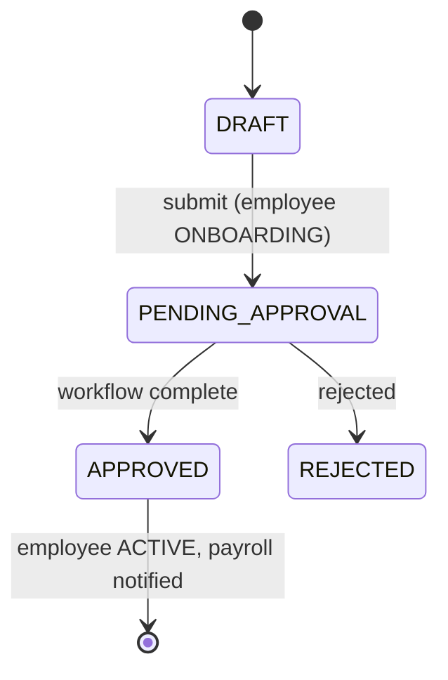
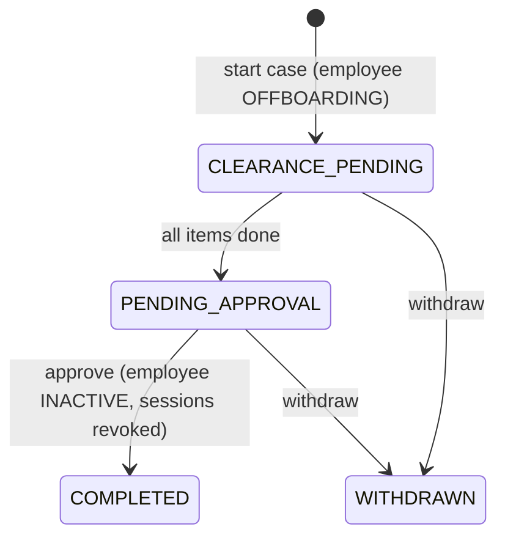

# Onboarding & offboarding

- Status: Planned
- Phase: 1
- Source modules: `src/modules/onboarding/`, `src/modules/offboarding/`

## Frontend sources

`app/onboarding/page.tsx` (10-step wizard, drafts, visa tracker), `lib/hiringHandoff.ts` (prefill from offer),
`context/SeparationContext.tsx`, `app/offboarding/page.tsx`, `app/team/separation`, `lib/workflow.ts`.

## Onboarding

Steps: Personal → Employment → Passport/Visa/EID (India: Passport/Aadhaar/PAN) → Emergency → Experience &
Education → Family → Bank & PF → Salary → Documents → Assets & Approval. Each step validated; all on submit.

- **Drafts** per HR user per offer (`gsit.onboarding.draft.v1:{viewer}:{offer|new}`) → `onboarding_drafts` table (JSONB).
- Probation end = joining + 6 months. Suggested email `{firstname}@gs-it.ae`.
- Prefill from accepted offer: salary line mapping (UAE Housing→Accommodation, Transport→Transportation;
  India yearly ÷ 12), employment type mapping (Full-time→Permanent, Contract→Contract, Intern→Probation).
- Submit → Employee `ONBOARDING` + onboarding request `PENDING_APPROVAL` + `hiring.completeHire` + "Hired" email.
- **UAE visa tracker**: 20 stages in 5 groups (Preparation, Work Permit/MOHRE, Entry Permit/GDRFA, Medical &
  Insurance, Emirates ID & Residence). Frontend keeps it only in the draft → persist per employee.
- Asset pre-provisioning flags; per-hire reminder preferences (days, recipients).

**Gap:** the frontend never reaches APPROVED / ACTIVE — define with the lead (open decision 5).

## Offboarding

- Reasons: Resignation, Termination, End of contract, Retirement, Other. Notice 0/15/30/60/90 days; last working
  day = resignation date + notice (overridable).
- Only ACTIVE employees without an open case.
- Clearance: Knowledge handover, Assets returned (auto-ticks when all assigned assets returned), Access revoked,
  Finance clearance, HR exit interview.

**Gap:** no employee self-resignation (employee → TL → HR) in the frontend — open decision 5.
Team Lead view is read-only for direct reports.

## Threat model

Onboarding collects the most sensitive data in one flow — drafts must be encrypted for sensitive fields and
visible only to their HR author + Super Admin. Completing offboarding must revoke sessions immediately.
