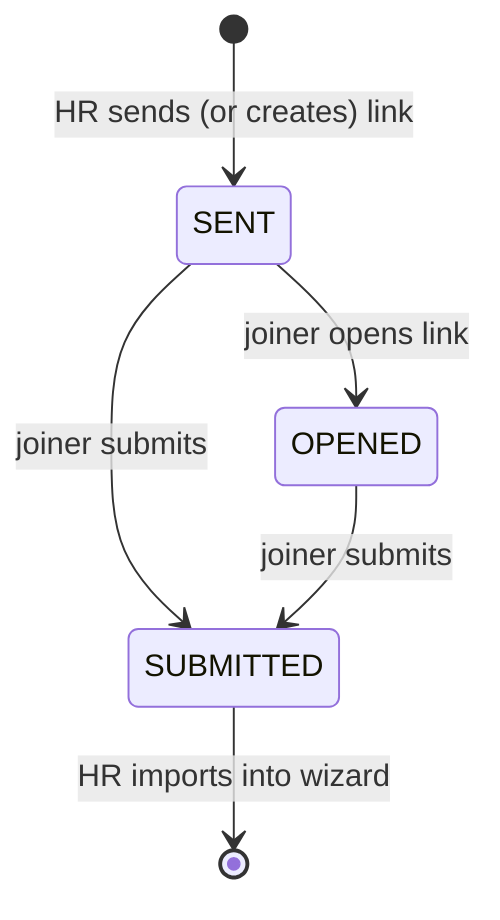
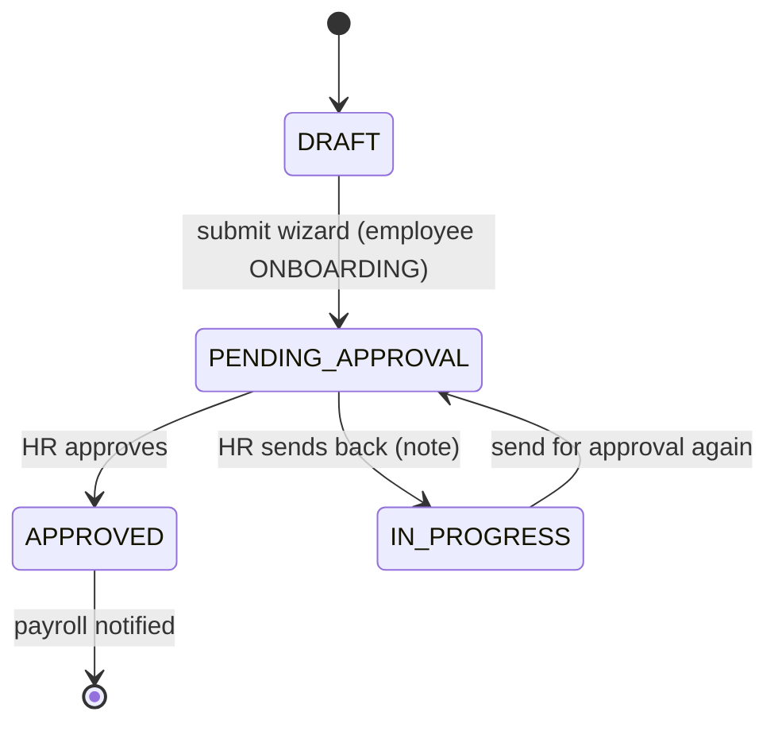
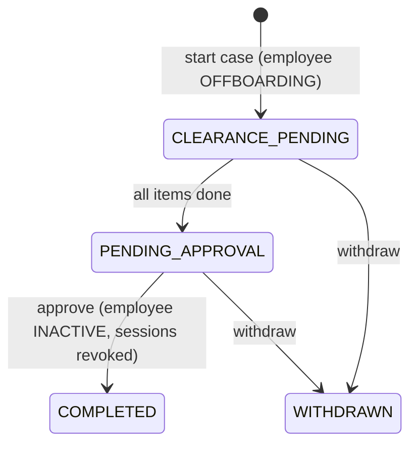

# Onboarding & offboarding

- Status: Planned
- Phase: 1
- Source modules: `src/modules/onboarding/`, `src/modules/offboarding/`

## Frontend sources

`app/onboarding/page.tsx` (list, 10-step wizard, drafts, approval drawer, visa tracker), `lib/hiringHandoff.ts`
(prefill from offer + joining form + pre-offer documents), `lib/onboardingForms.ts` + `app/onboarding/form/[token]`

- `components/onboarding/JoiningFormActions.tsx` (joining form), `lib/employeeStore.ts` (`addEmployee`,
  `decideOnboarding`, `resubmitOnboarding`), `lib/payroll.ts` (statutory figures), `lib/workflow.ts`,
  `context/SeparationContext.tsx`, `app/offboarding/page.tsx`, `app/team/separation`.

## Onboarding

Steps: Personal → Employment → Passport/Visa/EID (India: Passport/Aadhaar/PAN) → Emergency → Experience &
Education → Family → Bank & PF → Salary → Documents → Assets & Approval. Each step validated; all on submit.

- **List page**: tiles (in the pipeline, awaiting approval, starting in 30 days, average progress), _Accepted offers_
  waiting to start (hiring "full" access only), _In-progress_ onboardings (drafts + requests) filterable by status
  (In Progress / Pending Approval / Approved) and search.
- **Drafts** auto-save as HR types — one per HR user per offer, or per hand-started onboarding
  (`gsit.onboarding.draft.v1:{viewer}:{offerId | new:<id>}`; several hand-started drafts allowed). Drafts show in
  _In-progress_ with step N/10 and can be resumed or **discarded** → `onboarding_drafts` table (JSONB, sensitive
  fields encrypted).
- **Candidate backed out**: from an accepted offer (or its draft) HR withdraws the offer with a reason → offer
  `DECLINED`, position reopened, draft deleted (hiring `withdrawAcceptedOffer`, see `hiring.md`).
- Probation end = joining + 6 months. Suggested email `{firstname}@gs-it.ae`, `{first}.{last}@…` when taken.
- Prefill from accepted offer: salary line mapping (UAE Housing→Accommodation, Transport→Transportation;
  India yearly ÷ 12), employment type mapping (Full-time→Permanent, Contract→Contract, Intern→Probation); plus the
  submitted **joining form** and the **pre-offer documents** (label, files, verified) and background-verification
  referral collected in Hiring (shown as "Collected before the offer letter").
- **India fields**: first / middle / last name (required) besides the full name as per passport; name as per
  Aadhaar and as per PAN (required); passport **optional** for India; branch name (required); PF: already enrolled
  (Yes/No, required) → UAN (12 digits) + UAN-linked mobile required when Yes, previous PF member ID and EPS
  eligibility optional; bank account number typed twice (must match), IFSC validated.
- **Family** rows gain date of birth; experience/education rows can carry an uploaded letter/certificate;
  documents can carry a free-text detail (passport / Aadhaar details, certificate qualification & institution).
- **Salary step** computes statutory figures (`lib/payroll.ts`, indicative, payroll to confirm):
  India — PF on wages (≥ 50 % of gross, ceiling INR 15,000 unless "PF on full wage"), EPS 8.33 %, EDLI, admin 0.5 %,
  ESI 0.75 % / 3.25 % when gross ≤ INR 21,000, Kerala professional tax by half-year slab, gratuity, monthly CTC;
  UAE — ILOE (AED 5 / 10 by basic ≤ 16,000), pension for UAE nationals (11 % employee, 15 % employer less 2.5 %
  government share under AED 20,000, base capped 70,000), gratuity accrual. Employee deductions (EPF, ESI,
  Professional Tax, Pension 11 %) are **saved as salary deduction lines**; employer figures are display only.
- **Required documents** (`REQUIRED_DOCS`): UAE — Passport Copy, Signed Offer Letter, Attested Educational
  Certificate, Labour Card, Residence Visa, Emirates ID, Signed NDA, UAE Driving Licence, Medical Insurance E-Card,
  Passport Size Photo. India — Signed Offer Letter, Highest Educational Certificate, PAN Card, Aadhaar Card,
  Passbook / Bank Statement, Signed NDA, Signed Employment Contract, Passport Size Photo.
- Submit → Employee `ONBOARDING` + onboarding request `PENDING_APPROVAL` + `hiring.completeHire` + "Hired" email;
  joining form marked imported.
- **UAE visa tracker**: 20 stages in 5 groups (Preparation, Work Permit/MOHRE, Entry Permit/GDRFA, Medical &
  Insurance, Emirates ID & Residence). Frontend keeps it only in the draft → persist per employee.
- Asset pre-provisioning flags; per-hire reminder preferences (days, recipients).

### Joining form (new joiner self-service)

HR sends the joiner a private link (no sign-in; the token is the key) to fill in their own personal, identity,
bank, emergency, education, experience, family and document details. Their answers prefill the wizard.

- Created from an accepted offer (wizard banner, Offers page, Onboarding list) **or** for a hand-started
  onboarding (to the personal email). One form per offer/onboarding; resending keeps the same link and answers.
- Send dialog: to the company mailbox (suggested), copy to personal email, **due date** (today … joining date),
  email from template `tpl-joining` (Operations → Email templates; subject/body editable, merge fields
  `onboarding.link`, `onboarding.dueDate`, `onboarding.documents`). "Skip email: just copy the link" creates the
  link without mailing (`emailed = false`).
- Statuses `SENT → OPENED` (first open, HR notified) `→ SUBMITTED` (HR, Office Admin, Super Admin notified).
  Answers auto-save as a draft until submit; after submit the form is read-only ("already submitted").
- Joiner validation: names, DOB, gender, nationality, mobile, personal email, current address, identity numbers
  (Aadhaar/PAN + names for India; passport for UAE; passport not expired), bank with account number confirmed,
  PF for India, first emergency contact, passport-size photo, declaration ticked. Documents already collected
  before the offer are not asked again.
- If the form arrives after HR started the wizard, HR can "Fill from their form" into the draft.
- Every action is logged (sent / sent again / link created / opened / submitted).

### Approval

HR, Office Admin or Super Admin opens **Review & approve** on a `PENDING_APPROVAL` onboarding (who is joining,
position, location, joining date, work email, the configured chain from `lib/workflow.ts`) and either:

- **Approve** (optional note) → request `APPROVED`; HR roles told "payroll can now set up their salary".
- **Send back** (note required) → request back to `IN_PROGRESS`, flagged _Sent back_; HR fixes and
  **Send for approval again** → `PENDING_APPROVAL`.

Both decisions are audited (module Onboarding, field "Onboarding approval").

### Business rules

| Id         | Rule                                                                                                                                               |
| ---------- | -------------------------------------------------------------------------------------------------------------------------------------------------- |
| BR-ONB-001 | Only an `ACCEPTED` offer not yet linked to an employee can start onboarding                                                                        |
| BR-ONB-002 | One joining form per offer / onboarding; resending reuses the token and saved answers                                                              |
| BR-ONB-003 | Joining form token is single-purpose and unauthenticated; a submitted form cannot be changed or submitted again                                    |
| BR-ONB-004 | Joining form due date is between today and the joining date                                                                                        |
| BR-ONB-005 | Only `PENDING_APPROVAL` can be approved or sent back; send back needs a note                                                                       |
| BR-ONB-006 | Only a sent-back (`IN_PROGRESS`) request can be resubmitted                                                                                        |
| BR-ONB-007 | Statutory deductions are computed server-side from the salary (rules in `lib/payroll.ts`), never trusted from the client                           |
| BR-ONB-008 | India: first/last name, Aadhaar + name, PAN + name, branch name, PF enrolled required; UAN + linked mobile when enrolled; account number confirmed |
| BR-ONB-009 | Candidate backed out → offer `DECLINED` with reason, position reopened, draft removed                                                              |

**Gaps:**

- The approval stays HR-only; the chain's _Manager review_ step is shown but not enforced, and approving does not
  move the employee to `ACTIVE` — define with the lead (open decision 5).
- The joining-form due date is not enforced and the link never expires — backend must expire it (proposal: at
  due date + grace, or on employee creation) and rate-limit the public endpoint.
- No check that the approver is not the HR user who submitted the onboarding.
- Uploads (wizard and joining form) are recorded by file name only.

## Offboarding

- Reasons: Resignation, Termination, End of contract, Retirement, Other. Notice 0/15/30/60/90 days; last working
  day = resignation date + notice (overridable).
- Only ACTIVE employees without an open case.
- Clearance: Knowledge handover, Assets returned (auto-ticks when all assigned assets returned), Access revoked,
  Finance clearance, HR exit interview.

**Gap:** no employee self-resignation (employee → TL → HR) in the frontend — open decision 5.
Team Lead view is read-only for direct reports.

## Threat model

Onboarding collects the most sensitive data in one flow — drafts must be encrypted for sensitive fields and
visible only to their HR author + Super Admin. The joining form is a **public, token-only** endpoint that accepts
identity and bank data: high-entropy single-use token, expiry, rate limit, no echo of saved sensitive values
beyond what the joiner typed, file type/size checks, and audit of open/save/submit. Completing offboarding must revoke sessions immediately.
