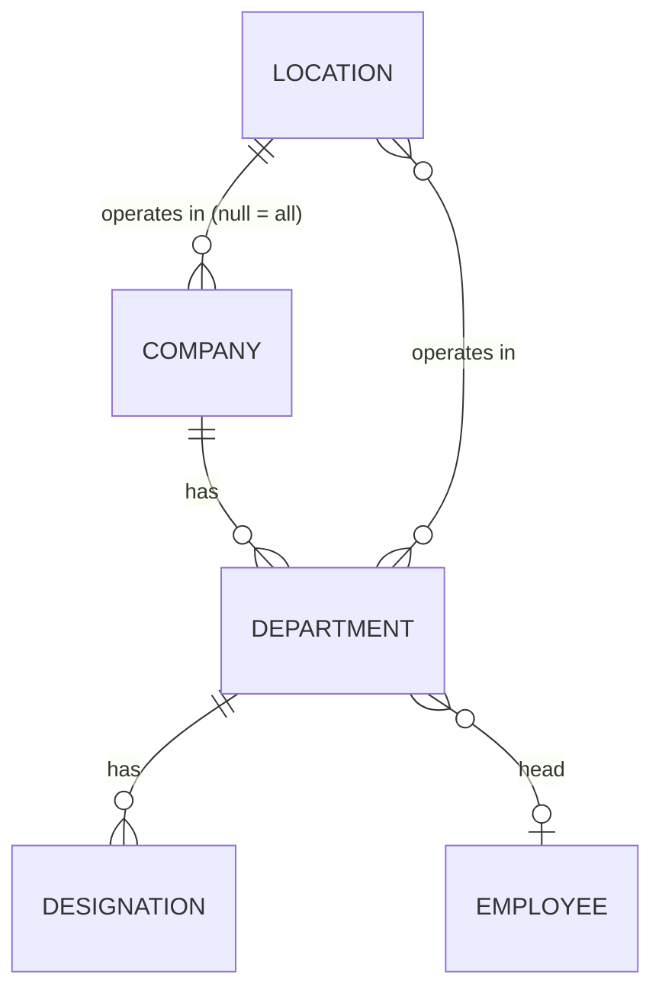

# Organization

- Status: In progress (companies done)
- Phase: 0
- Source module: `src/modules/org/` — **reference implementation for every other module**

## 1. Purpose and scope

Master data every other module references: locations (country rules), companies (business units),
departments (per company, per location) and designations (per department).

## 2. Frontend sources

`context/OrgContext.tsx` (add/update/remove + `locationUsage`), `app/admin/companies`, `app/admin/structure`,
`app/admin/settings` (locations), `lib/org.ts` (legal entity per location), `lib/headcount.ts`.
The frontend stores company/department/designation **names** on employees — the API uses ids.

## 3. Entities

- **Location**: readable id (`Dubai`, `Kochi`), currency, timezone, phone format, working hours, seating[],
  `template` UAE | INDIA, `system` (cannot be deleted).
- **Company**: name, shortCode (unique), description, website, location (null = "Both"), established, status.
- **Department**: company, name (unique per company), locations[], head employee.
- **Designation**: department, title (unique per department).
- Legal entity per location (`Global Surf IT LLC` / `Global Surf IT Pvt Ltd`) — to add as a Location column.

## 5. Business rules

| Id         | Rule                                                                                                                | Enforced in                        | Test                    |
| ---------- | ------------------------------------------------------------------------------------------------------------------- | ---------------------------------- | ----------------------- |
| BR-ORG-001 | Short code 2–8 letters/digits, stored upper-case                                                                    | `domain/company.rules.ts`          | `company.rules.spec.ts` |
| BR-ORG-002 | "Both" ⇄ `location_id = null`                                                                                       | `domain/company.rules.ts`          | `company.rules.spec.ts` |
| BR-ORG-003 | Company location must exist                                                                                         | `application/companies.service.ts` | `companies.e2e-spec.ts` |
| BR-ORG-004 | System locations cannot be deleted; a location in use (companies, departments, employees) cannot be deleted         | to do                              | —                       |
| BR-ORG-005 | Deleting a company removes its departments/designations only when no employee references them; otherwise deactivate | to do                              | —                       |
| BR-ORG-006 | An employee's department must belong to their company **and** operate in their location                             | employees module                   | —                       |

## 6. Access

| Action                                            | Rule                                                 |
| ------------------------------------------------- | ---------------------------------------------------- |
| Read companies/departments/designations/locations | `@SignedIn` (used by forms everywhere)               |
| Create / edit / delete companies                  | `administration:admin-companies` add / edit / delete |
| Departments & designations                        | `administration:admin-structure`                     |
| Locations                                         | `administration:admin-settings`                      |

## 7. Endpoints

| Method | Path                                 | Access               |
| ------ | ------------------------------------ | -------------------- |
| GET    | `/api/org/companies`                 | SignedIn             |
| GET    | `/api/org/companies/:id`             | SignedIn             |
| POST   | `/api/org/companies`                 | admin-companies#add  |
| PATCH  | `/api/org/companies/:id`             | admin-companies#edit |
| —      | locations, departments, designations | to do                |

## 8. Events

Published (planned): `org.department.renamed`, `org.location.updated` (calendar/policy caches).

## 9. Threat model

Low sensitivity data, but changes affect every employee's placement and country rules → mutations are
permission-gated and audited (module `Organization`).
