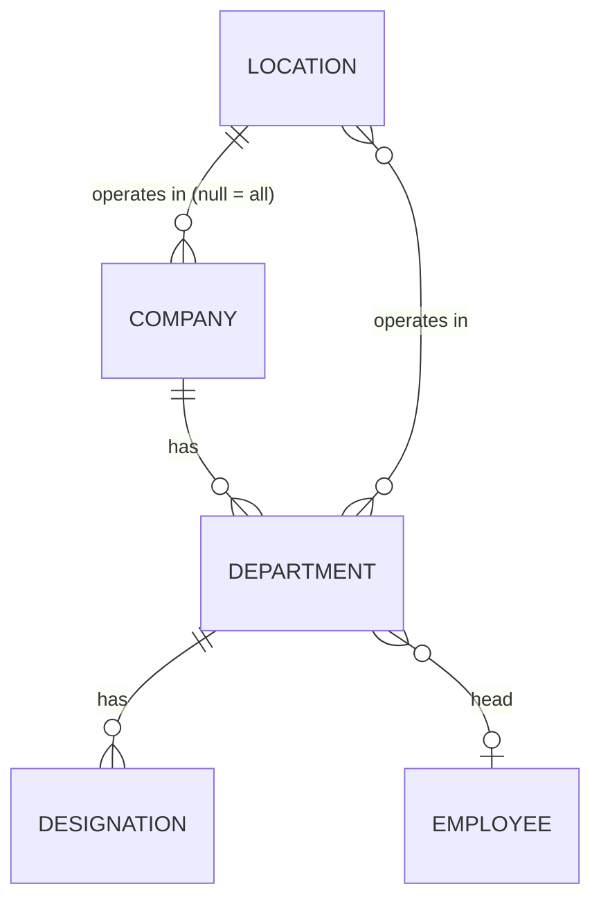

# Organization

- Status: In progress (companies, locations, departments and designations done; company delete to do)
- Phase: 0
- Source module: `src/modules/org/` — **reference implementation for every other module**

## 1. Purpose and scope

Master data every other module references: locations (country rules), companies (business units),
departments (per company, per location) and designations (per department).

## 2. Frontend sources

`context/OrgContext.tsx` (add/update/remove + `locationUsage`), `app/admin/companies`, `app/admin/structure`,
`app/admin/settings` (locations), `lib/org.ts` (legal entity per location), `lib/headcount.ts`.
The frontend stores company/department/designation **names** on employees — the API uses ids.

## 3. Entities

- **Location**: readable id (`Dubai`, `Kochi`), currency, timezone, phone format, working hours, seating[],
  `template` UAE | INDIA, `system` (cannot be deleted).
- **Company**: name, shortCode (unique), description, website, location (null = "Both"), established, status.
- **Department**: company, name (unique per company), locations[], head employee.
- **Designation**: department, title (unique per department).
- Legal entity per location (`Global Surf IT LLC` / `Global Surf IT Pvt Ltd`) — to add as a Location column.

## 5. Business rules

| Id         | Rule                                                                                                                                                                                                                                                 | Enforced in                                                    | Test                                                |
| ---------- | ---------------------------------------------------------------------------------------------------------------------------------------------------------------------------------------------------------------------------------------------------- | -------------------------------------------------------------- | --------------------------------------------------- |
| BR-ORG-001 | Short code 2–8 letters/digits, stored upper-case                                                                                                                                                                                                     | `domain/company.rules.ts`                                      | `company.rules.spec.ts`                             |
| BR-ORG-002 | "Both" ⇄ `location_id = null`                                                                                                                                                                                                                        | `domain/company.rules.ts`                                      | `company.rules.spec.ts`                             |
| BR-ORG-003 | Company location must exist                                                                                                                                                                                                                          | `application/companies.service.ts`                             | `companies.e2e-spec.ts`                             |
| BR-ORG-004 | System locations cannot be deleted; a location in use (companies, departments, employees, requisitions, candidates) cannot be deleted                                                                                                                | `domain/location.rules.ts`                                     | `location.rules.spec.ts`, `locations.e2e-spec.ts`   |
| BR-ORG-005 | Deleting a company removes its departments/designations only when no employee references them; otherwise deactivate                                                                                                                                  | to do                                                          | —                                                   |
| BR-ORG-006 | An employee's department must belong to their company **and** operate in their location                                                                                                                                                              | employees module                                               | —                                                   |
| BR-ORG-007 | Location names are unique, ignoring case                                                                                                                                                                                                             | `application/locations.service.ts`                             | `locations.e2e-spec.ts`                             |
| BR-ORG-008 | Phone country code is "+" and 1–4 digits; spaces removed                                                                                                                                                                                             | `domain/location.rules.ts`                                     | `location.rules.spec.ts`                            |
| BR-ORG-009 | Seating entries trimmed, blanks dropped, unique ignoring case                                                                                                                                                                                        | `domain/location.rules.ts`                                     | `location.rules.spec.ts`                            |
| BR-ORG-010 | The template (employee form rules) of a built-in location cannot change                                                                                                                                                                              | `domain/location.rules.ts`                                     | `location.rules.spec.ts`, `locations.e2e-spec.ts`   |
| BR-ORG-011 | Location ids are made by the server from the city (or name): readable, never "Both", suffixed -2, -3 when taken                                                                                                                                      | `domain/location.rules.ts`                                     | `location.rules.spec.ts`                            |
| BR-ORG-012 | Department names are unique within a company, ignoring case                                                                                                                                                                                          | `application/departments.service.ts`                           | `structure.e2e-spec.ts`                             |
| BR-ORG-013 | A department has at least one location; each exists and is the company location unless the company operates everywhere                                                                                                                               | `domain/department.rules.ts`                                   | `department.rules.spec.ts`, `structure.e2e-spec.ts` |
| BR-ORG-014 | A department head is a current (not INACTIVE) employee of the same company                                                                                                                                                                           | `domain/department.rules.ts`                                   | `department.rules.spec.ts`, `structure.e2e-spec.ts` |
| BR-ORG-015 | Designation titles are unique within a department, ignoring case                                                                                                                                                                                     | `application/designations.service.ts`                          | `structure.e2e-spec.ts`                             |
| BR-ORG-016 | A department or designation still used by employees, requisitions or jobs cannot be deleted (the foreign keys are SET NULL, so the check runs in the delete transaction with the rows locked). An unused department is deleted with its designations | `domain/department.rules.ts`, `infrastructure/*.repository.ts` | `department.rules.spec.ts`, `structure.e2e-spec.ts` |
| BR-ORG-017 | A location cannot be removed from a department while its current employees work there                                                                                                                                                                | `domain/department.rules.ts`                                   | `department.rules.spec.ts`, `structure.e2e-spec.ts` |

## 6. Access

| Action                                            | Rule                                                 |
| ------------------------------------------------- | ---------------------------------------------------- |
| Read companies/departments/designations/locations | `@SignedIn` (used by forms everywhere)               |
| Create / edit / delete companies                  | `administration:admin-companies` add / edit / delete |
| Departments & designations                        | `administration:admin-structure`                     |
| Locations                                         | `administration:admin-settings`                      |

## 7. Endpoints

| Method | Path                                             | Access                 |
| ------ | ------------------------------------------------ | ---------------------- |
| GET    | `/api/org/companies`                             | SignedIn               |
| GET    | `/api/org/companies/:id`                         | SignedIn               |
| POST   | `/api/org/companies`                             | admin-companies#add    |
| PATCH  | `/api/org/companies/:id`                         | admin-companies#edit   |
| GET    | `/api/org/locations`                             | SignedIn               |
| GET    | `/api/org/locations/:id`                         | SignedIn               |
| POST   | `/api/org/locations`                             | admin-settings#add     |
| PATCH  | `/api/org/locations/:id`                         | admin-settings#edit    |
| DELETE | `/api/org/locations/:id`                         | admin-settings#delete  |
| GET    | `/api/org/departments` (?companyId, ?locationId) | SignedIn               |
| GET    | `/api/org/departments/:id`                       | SignedIn               |
| POST   | `/api/org/departments`                           | admin-structure#add    |
| PATCH  | `/api/org/departments/:id`                       | admin-structure#edit   |
| DELETE | `/api/org/departments/:id`                       | admin-structure#delete |
| GET    | `/api/org/designations` (?departmentId)          | SignedIn               |
| GET    | `/api/org/designations/:id`                      | SignedIn               |
| POST   | `/api/org/designations`                          | admin-structure#add    |
| PATCH  | `/api/org/designations/:id`                      | admin-structure#edit   |
| DELETE | `/api/org/designations/:id`                      | admin-structure#delete |

## 8. Events

Published (planned): `org.department.renamed`, `org.location.updated` (calendar/policy caches).

## 9. Threat model

Low sensitivity data, but changes affect every employee's placement and country rules → mutations are
permission-gated and audited (module `Organization`).
