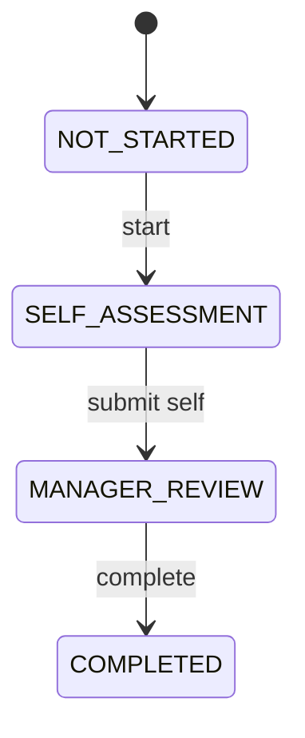

# Performance & learning

- Status: Planned
- Phase: 4
- Source modules: `src/modules/performance/`, `src/modules/learning/`

## Frontend sources

`context/PerformanceContext.tsx`, `app/performance`, `context/LearningContext.tsx`, `app/learning`.

## Performance

Review: employee, cycle, status, rating 1–5 (Needs improvement … Outstanding), due date, self rating/comments,
manager comments, goals (free text), completed on.

Create cycle = one review per chosen active employee (skip duplicates). Remove only NOT_STARTED. Team Lead sees
direct reports. **Backend should add a Cycle entity** (frontend derives cycles from strings) and goals/KPIs later.

## Learning

Record: employee, course, category, status (NOT_STARTED | IN_PROGRESS | COMPLETED), assigned/due/completed,
score 0–100, notes. Bulk assign (dedupe per course), start, complete, reopen, unassign (NOT_STARTED only).
Overdue = not completed and past due. **Backend should add a Course catalogue entity.**
