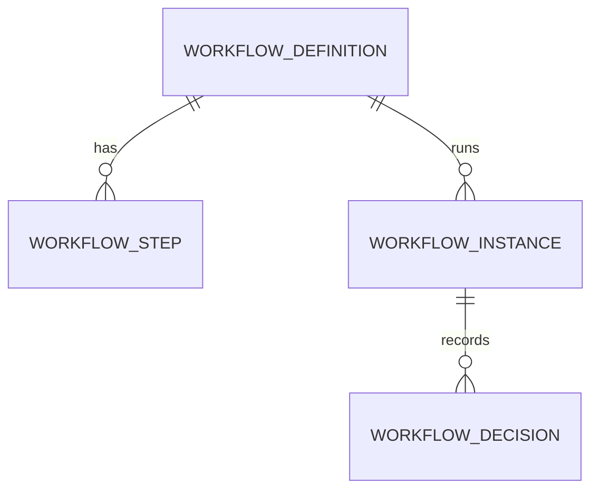

# Platform (core)

- Status: In progress
- Phase: 0
- Source: `src/core/`

## Frontend sources

`lib/api.ts`, `lib/auth.ts`, `lib/guard.ts`, `lib/nav.ts`, `lib/access.ts`, `lib/rolesApi.ts`, `app/login`,
`app/admin/roles`, `lib/workflow.ts`,
`app/admin/workflow`, `lib/notifications.ts`, `components/notifications/*`, `app/admin/notifications`,
`lib/reminderRules.ts`, `app/admin/reminders`, `lib/employeeStore.ts` (`logAudit`), `lib/activity.ts`, `app/admin/audit`.

**Connected to this API** (frontend `82bcda4` + `ca8bbd9`, 2026-10-29): sign-in, the session and Roles &
Permissions. `lib/api.ts` calls `/api/*` on the app's own origin (the Next dev server proxies to the backend;
Front Door in Azure), so the httpOnly cookie and the Origin check work. A 401 outside `/auth/*` sends the user back
to sign-in. Builds with no backend (`NEXT_PUBLIC_HRMS_API=off`) keep a browser-only demo session on mock data.

**What the frontend still fakes:** "Continue with Microsoft" only shows a notice (it does not call
`/api/auth/login`); `can()` and the menus still use the frontend's own role defaults, not `/api/auth/me`
permissions; a role the frontend does not know (any custom role) is treated as Employee on screen; custom
features ("Add feature") are disabled when connected; nobody can be given a role from the UI yet; workflow chains are
display labels; notification rules and workflow toggles are not read by anything; email is never sent.

## Auth & sessions — done

See [ADR-0003](../adr/0003-entra-sso-server-sessions.md) and `docs/security.md`.

| Method | Path                           | Access                                                                                                                                                           |
| ------ | ------------------------------ | ---------------------------------------------------------------------------------------------------------------------------------------------------------------- |
| GET    | `/api/auth/login?returnTo=`    | Public — redirects to Microsoft                                                                                                                                  |
| GET    | `/api/auth/callback`           | Public — Entra redirect URI                                                                                                                                      |
| POST   | `/api/auth/dev/login`          | Public, dev only (404 otherwise)                                                                                                                                 |
| POST   | `/api/auth/dev/password-login` | Public — the login page's email + password form; demo accounts (`…@hrms.local`) only, shared `DEV_LOGIN_PASSWORD`; on in every environment until Entra is set up |
| GET    | `/api/auth/dev/personas`       | Public — the demo accounts listed on the login page                                                                                                              |
| GET    | `/api/auth/me`                 | SignedIn                                                                                                                                                         |
| POST   | `/api/auth/logout`             | SignedIn                                                                                                                                                         |

## IAM — roles & permissions API and data scopes done; custom features to do

- **Roles**: 7 system roles (Super Admin, HR, Office Admin, Talent Acquisition Manager, Team Lead, Recruiter, Employee) + custom roles.
  System roles cannot be renamed/deleted. Employee has exactly one role.
- **Changed in the frontend (`8609a8e`, 2026-10-29) — to port**: two more system roles, **Talent Acquisition
  Manager** (demo GS-155, GS IT · HR, reports to GS-120) and **Recruiter** (demo GS-156, reports to GS-155). Order:
  Super Admin, HR, Office Admin, Talent Acquisition Manager, Team Lead, Recruiter, Employee.

  | Role                       | Rank | Areas / Home scopes | Default grants                                                                                               |
  | -------------------------- | ---- | ------------------- | ------------------------------------------------------------------------------------------------------------ |
  | Talent Acquisition Manager | 2    | home · `my`, `team` | Every Hiring category, all actions except Delete; elsewhere like Team Lead (rank ≤ 2, no Delete)             |
  | Recruiter                  | 1    | home · `my`         | Hiring → **Recruiting** category only, all actions except Delete; elsewhere like Employee (rank 1, Add only) |

  Data scope: the manager sees all of Hiring and their direct reports; a Recruiter sees only the jobs assigned to
  them (and those jobs' candidates, interviews and offers) — see `hiring.md`.

- **Permission catalogue**: Module → Category → Feature, keys `<feature>` / `<feature>#add|edit|delete`
  (`lib/access.ts`). Modules: administration (common), employee, hiring, leave-attendance, asset-management,
  payroll, renewals. Add/Edit/Delete imply View. Custom features can be added by Super Admin.
- **Defaults** (`defaultGrants`): category rank 1–5 vs role rank; HR no Delete in Administration; Office Admin
  never Delete; Team Lead/Employee limited actions on rank ≤ 2.
- **Drift found 2026-10-30**: the frontend catalogue has `employee:team:requests` (Team → Requests, `/team/requests`)
  which is missing from `feature-catalog.ts` and the snapshot — Team Lead and Super Admin should get it by default.
- **Done**: the full catalogue (112 features, all modules) and the default grants are ported in
  `src/core/iam/feature-catalog.ts`; a unit test proves they equal a frontend snapshot, so `/api/auth/me`
  returns the keys the frontend's `can()` expects. Known frontend bug kept for parity: its `READ_ONLY` regex has
  a stray backspace after `log`, so "Reminder log" is editable — fix in the frontend, then here.
- **Data scopes — done** (`src/core/iam/data-scope.ts`, decided by permission; see `employees.md`): Employee=SELF,
  Team Lead=TEAM (direct reports only), HR/Super Admin=ALL locations,
  Office Admin=ALL (the frontend's own-location `defaultScope` is only a starting filter). Talent Acquisition Manager=TEAM outside
  Hiring; Recruiter=SELF outside Hiring (inside Hiring: assigned jobs only).
- **Never** let anyone change their own role or grants.

### Roles & permissions API (`src/core/iam/`) — done

All `administration:admin-roles` (View for reads; Add / Edit / Delete as listed). Every change is audited in the same
transaction (module `Access`: `role.created`, `role.updated`, `role.permissions_changed` with granted/revoked
keys, `role.deleted`, `employee.role_changed`) and ends the sessions it affects, so nobody keeps working with a
stale grant set.

| Method | Path                                   | Access | What                                                                    |
| ------ | -------------------------------------- | ------ | ----------------------------------------------------------------------- |
| GET    | `/api/iam/catalog`                     | view   | Module → category → feature with allowed actions (builds the grid)      |
| GET    | `/api/iam/roles`, `/api/iam/roles/:id` | view   | Roles with permission keys and member count                             |
| POST   | `/api/iam/roles`                       | add    | Custom role, optional initial permissions                               |
| PATCH  | `/api/iam/roles/:id`                   | edit   | Rename (custom only) / description                                      |
| PUT    | `/api/iam/roles/:id/permissions`       | edit   | Replace the grant set; returns granted/revoked; members' sessions ended |
| DELETE | `/api/iam/roles/:id`                   | delete | Custom role with no members                                             |
| PUT    | `/api/iam/employees/:employeeId/role`  | edit   | Give someone another role; their sessions ended                         |

| Id         | Rule                                                                                                      | Enforced in                                              |
| ---------- | --------------------------------------------------------------------------------------------------------- | -------------------------------------------------------- |
| BR-IAM-001 | Role names 2–60 characters, unique ignoring case                                                          | `role.rules.ts`, `roles.service.ts`                      |
| BR-IAM-002 | Keys exist in the catalogue, the action is allowed for the feature, Add/Edit/Delete need View             | `role.rules.ts`                                          |
| BR-IAM-003 | Nobody changes their own role or its permissions                                                          | `role.rules.ts`, `roles.service.ts`                      |
| BR-IAM-004 | You can only grant permissions you hold yourself                                                          | `role.rules.ts` (checked inside the locked transaction)  |
| BR-IAM-005 | The Super Admin role always has every permission; its grants cannot change                                | `role.rules.ts`                                          |
| BR-IAM-006 | You can only assign roles whose permissions you hold, to someone whose current role does not exceed yours | `role.rules.ts`                                          |
| BR-IAM-007 | System roles are never renamed or deleted; a role someone has cannot be deleted                           | `role.rules.ts` (member count in the locked transaction) |

BR-IAM-004 to 006 are not in the frontend: they stop privilege escalation, because HR and Office Admin hold
Roles → Add/Edit by default. Tests: `role.rules.spec.ts`, `test/admin/roles.e2e-spec.ts`.

The frontend Roles & Permissions screen is **connected** (frontend `82bcda4`): it reads `GET /iam/catalog` and
`GET /iam/roles`, saves each permission click with `PUT /iam/roles/:id/permissions` (whole set, queued per role,
rolled back to the server's set when refused), and uses `POST`/`PATCH`/`DELETE /iam/roles`. Its role page,
Compare view (up to 4 roles), **Duplicate** and **"copy an existing role"** in the three-step Add role popup are all
client-side — they end in a normal `POST /iam/roles` with the copied keys, so BR-IAM-004 still applies.

To do: **custom features** (the frontend's "Add feature" — needs a table; disabled while connected) and a UI for
`PUT /iam/employees/:id/role`.
`npm run db:seed` resets the system roles' grants to the defaults.

## Workflow engine — to do ([ADR-0004](../adr/0004-workflow-engine.md))

Chains to seed (from `lib/workflow.ts` and module code):

| Key              | Steps                                                                                                                         |
| ---------------- | ----------------------------------------------------------------------------------------------------------------------------- |
| onboarding       | HR initiates → Manager review → HR approval → Payroll notified                                                                |
| offboarding      | Resignation logged → Manager / IT / Finance clearance → HR final approval                                                     |
| requisition      | Hiring Manager (`RECORD_FIELD hiringManagerId`, auto-approved if submitter) → HR (HR/Office Admin) → Management (Super Admin) |
| employee-request | Information Update → reporting manager; others → HR                                                                           |
| leave            | Reporting manager → manager's manager → HR → Super Admin → external MD (fallback chain)                                       |
| expense          | Reporting manager; claimant with no manager/General Manager → Super Admin; over-limit → extra management step                 |
| encashment       | Manager → HR → payroll queue                                                                                                  |

Admin toggles currently shown in the UI (`exp-limit`, `onb-payroll`, `off-clearance`, `req-manager`) become
step conditions.

## Notifications — to do

- In-app notice: kind (request, expense, hiring, expiry, review, learning, system), tone, title, sub, href, at,
  recipients by employee ids and/or roles; actor never notified of own action; per-user read state.
- Rules (`app/admin/notifications`): event → in-app / email → recipients (Employee, HR, Manager, Approver) → on/off.
- Time-based alerts computed live in the frontend (`useNotifications`) become scheduled jobs: pending decisions,
  expiring documents, reviews/training due in 7 days or overdue, interviews in 1 h / 24 h, offers expiring in 3 days.

## Reminders — to do (with compliance)

Schedules (`lib/reminderRules.ts`): visa/EID/work permit 90/60/30/7; passport 90/30; labour card 60/30/7;
licences 90/60/30; contract 60/30 (off); other 60/30/7. Admin can toggle; lead times and recipients to become editable.

## Audit — done

`audit_logs` is append-only (database trigger). Write side: `AuditService.record(entry, tx)` from every module.
Read side (`src/core/audit/`), all `administration:admin-audit` **View** (a read-only screen: no Add/Edit/Delete
is ever granted):

| Method | Path                       | What                                                                                                                                                                                                                                                                                |
| ------ | -------------------------- | ----------------------------------------------------------------------------------------------------------------------------------------------------------------------------------------------------------------------------------------------------------------------------------- |
| GET    | `/api/admin/audit`         | Newest first, paged (pageSize ≤ 200). Filters: `q` (actor, module, action, entity), `module`, `action`, `actorId`, `entityType`, `entityId`, `from`/`to` (ISO instants — the client turns day pickers into instants in its timezone). Day grouping is done on the client from `at`. |
| GET    | `/api/admin/audit/filters` | Distinct modules, actions and actors (latest name) for the dropdowns                                                                                                                                                                                                                |
| GET    | `/api/admin/audit/export`  | CSV via `shared/security/csv.ts`, same filters, ≤ 10,000 rows (else 400 `audit.export_too_large`). The export is itself audited: `Security · audit.exported` with the filters and row count                                                                                         |

To do: view-access logging for sensitive records (salary, identity documents).

## Jobs, files, mail, PDF — to do

pg-boss ([ADR-0007](../adr/0007-pg-boss-jobs.md)); Blob with user-delegation SAS and Defender scan gate;
SMTP locally / Microsoft Graph in Azure with mail log; Gotenberg PDF with JS disabled.
