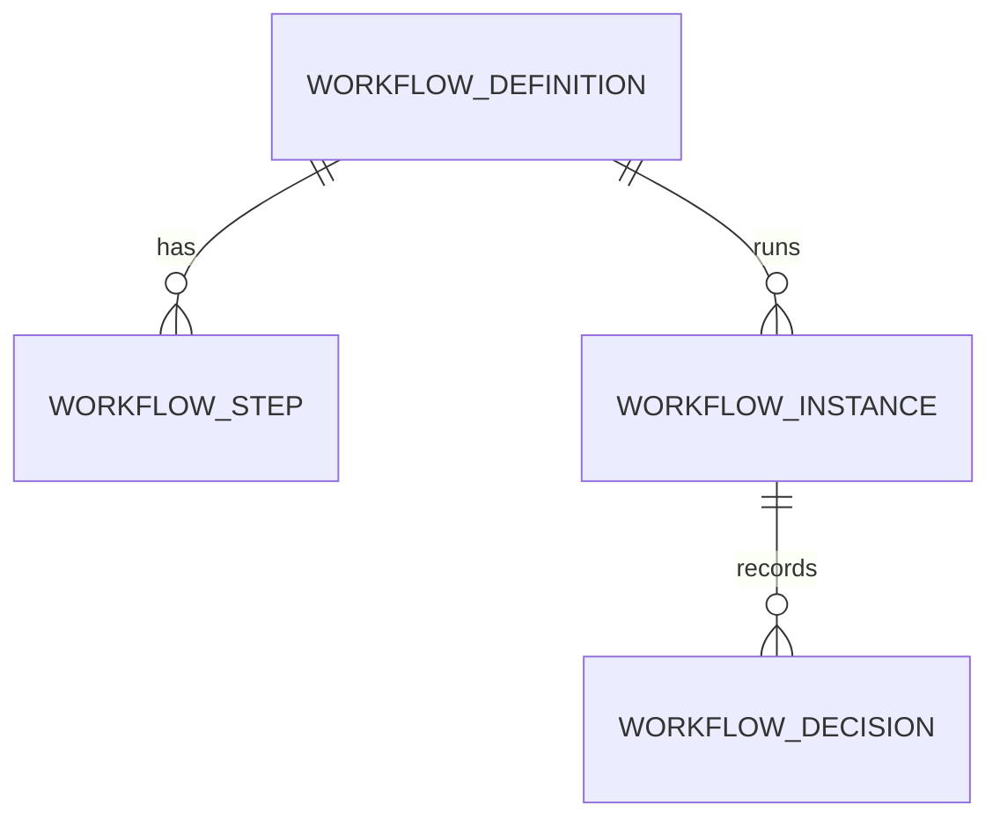

# Platform (core)

- Status: In progress
- Phase: 0
- Source: `src/core/`

## Frontend sources

`lib/auth.ts`, `lib/guard.ts`, `lib/nav.ts`, `lib/access.ts`, `app/admin/roles`, `lib/workflow.ts`,
`app/admin/workflow`, `lib/notifications.ts`, `components/notifications/*`, `app/admin/notifications`,
`lib/reminderRules.ts`, `app/admin/reminders`, `lib/employeeStore.ts` (`logAudit`), `lib/activity.ts`, `app/admin/audit`.

**What the frontend fakes:** no password/SSO check; the permission matrix is never enforced (`can()` unused);
custom roles are lost on reload and never assigned to users; workflow chains are display labels; notification
rules and workflow toggles are not read by anything; email is never sent.

## Auth & sessions — done

See [ADR-0003](../adr/0003-entra-sso-server-sessions.md) and `docs/security.md`.

| Method | Path                        | Access                           |
| ------ | --------------------------- | -------------------------------- |
| GET    | `/api/auth/login?returnTo=` | Public — redirects to Microsoft  |
| GET    | `/api/auth/callback`        | Public — Entra redirect URI      |
| POST   | `/api/auth/dev/login`       | Public, dev only (404 otherwise) |
| GET    | `/api/auth/dev/personas`    | Public, dev only                 |
| GET    | `/api/auth/me`              | SignedIn                         |
| POST   | `/api/auth/logout`          | SignedIn                         |

## IAM — to do

- **Roles**: 5 system roles (Super Admin, HR, Office Admin, Team Lead, Employee) + custom roles.
  System roles cannot be renamed/deleted. Employee has exactly one role.
- **Permission catalogue**: Module → Category → Feature, keys `<feature>` / `<feature>#add|edit|delete`
  (`lib/access.ts`). Modules: administration (common), employee, hiring, leave-attendance, asset-management,
  payroll, renewals. Add/Edit/Delete imply View. Custom features can be added by Super Admin.
- **Defaults** (`defaultGrants`): category rank 1–5 vs role rank; HR no Delete in Administration; Office Admin
  never Delete; Team Lead/Employee limited actions on rank ≤ 2.
- **Data scopes**: Employee=SELF, Team Lead=TEAM (direct reports only), HR/Super Admin=ALL locations,
  Office Admin=own location by default (`defaultScope`, `lib/data.ts`).
- Endpoints: list catalogue, CRUD roles, set grants (bulk), assign role to employee — `administration:admin-roles`.
  Every change audited (module `Access`) and the affected employees' sessions revoked.
- **Never** let anyone change their own role or grants.

## Workflow engine — to do ([ADR-0004](../adr/0004-workflow-engine.md))

Chains to seed (from `lib/workflow.ts` and module code):

| Key              | Steps                                                                                                                         |
| ---------------- | ----------------------------------------------------------------------------------------------------------------------------- |
| onboarding       | HR initiates → Manager review → HR approval → Payroll notified                                                                |
| offboarding      | Resignation logged → Manager / IT / Finance clearance → HR final approval                                                     |
| requisition      | Hiring Manager (`RECORD_FIELD hiringManagerId`, auto-approved if submitter) → HR (HR/Office Admin) → Management (Super Admin) |
| employee-request | Information Update → reporting manager; others → HR                                                                           |
| leave            | Reporting manager → manager's manager → HR → Super Admin → external MD (fallback chain)                                       |
| expense          | Reporting manager; claimant with no manager/General Manager → Super Admin; over-limit → extra management step                 |
| encashment       | Manager → HR → payroll queue                                                                                                  |

Admin toggles currently shown in the UI (`exp-limit`, `onb-payroll`, `off-clearance`, `req-manager`) become
step conditions.

## Notifications — to do

- In-app notice: kind (request, expense, hiring, expiry, review, learning, system), tone, title, sub, href, at,
  recipients by employee ids and/or roles; actor never notified of own action; per-user read state.
- Rules (`app/admin/notifications`): event → in-app / email → recipients (Employee, HR, Manager, Approver) → on/off.
- Time-based alerts computed live in the frontend (`useNotifications`) become scheduled jobs: pending decisions,
  expiring documents, reviews/training due in 7 days or overdue, interviews in 1 h / 24 h, offers expiring in 3 days.

## Reminders — to do (with compliance)

Schedules (`lib/reminderRules.ts`): visa/EID/work permit 90/60/30/7; passport 90/30; labour card 60/30/7;
licences 90/60/30; contract 60/30 (off); other 60/30/7. Admin can toggle; lead times and recipients to become editable.

## Audit — done

`audit_logs` is append-only (database trigger). Write side: `AuditService.record(entry, tx)` from every module.
Read side (`src/core/audit/`), all `administration:admin-audit` **View** (a read-only screen: no Add/Edit/Delete
is ever granted):

| Method | Path                       | What                                                                                                                                                                                                                                                                                |
| ------ | -------------------------- | ----------------------------------------------------------------------------------------------------------------------------------------------------------------------------------------------------------------------------------------------------------------------------------- |
| GET    | `/api/admin/audit`         | Newest first, paged (pageSize ≤ 200). Filters: `q` (actor, module, action, entity), `module`, `action`, `actorId`, `entityType`, `entityId`, `from`/`to` (ISO instants — the client turns day pickers into instants in its timezone). Day grouping is done on the client from `at`. |
| GET    | `/api/admin/audit/filters` | Distinct modules, actions and actors (latest name) for the dropdowns                                                                                                                                                                                                                |
| GET    | `/api/admin/audit/export`  | CSV via `shared/security/csv.ts`, same filters, ≤ 10,000 rows (else 400 `audit.export_too_large`). The export is itself audited: `Security · audit.exported` with the filters and row count                                                                                         |

To do: view-access logging for sensitive records (salary, identity documents).

## Jobs, files, mail, PDF — to do

pg-boss ([ADR-0007](../adr/0007-pg-boss-jobs.md)); Blob with user-delegation SAS and Defender scan gate;
SMTP locally / Microsoft Graph in Azure with mail log; Gotenberg PDF with JS disabled.
